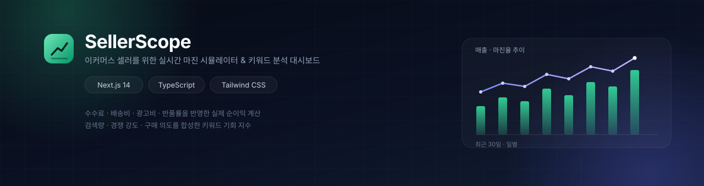
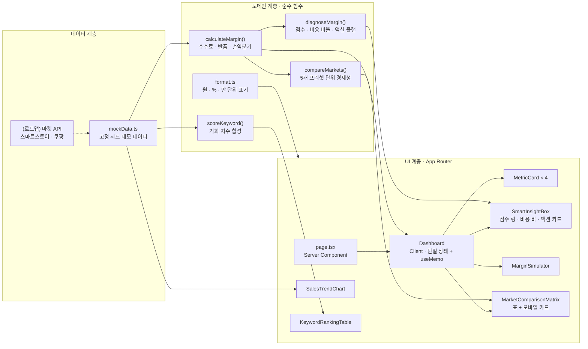
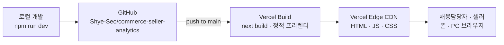

<div align="center">
  
</div>

<h1 align="center">SellerScope</h1>

<p align="center">
  스마트스토어 · 쿠팡 셀러를 위한 <strong>실시간 마진 시뮬레이터</strong> · <strong>AI 마진 진단</strong> &amp; <strong>5대 마켓 비교</strong> 대시보드
</p>

<p align="center">
  <a href="https://nextjs.org"></a>
  <a href="https://www.typescriptlang.org"></a>
  <a href="https://tailwindcss.com"></a>
  <a href="https://vitest.dev"></a>
</p>

<p align="center">
  <a href="https://vercel.com/new/clone?repository-url=https%3A%2F%2Fgithub.com%2FShye-Seo%2Fcommerce-seller-analytics&project-name=commerce-seller-analytics&repository-name=commerce-seller-analytics">
    
  </a>
</p>

<p align="center">
  <sub>위 버튼을 누르면 내 Vercel 계정으로 이 대시보드가 그대로 배포됩니다. 환경변수·API 키가 필요 없습니다. 자세한 절차는 <a href="#54-vercel-원클릭-배포">5.4 Vercel 원클릭 배포</a>.</sub>
</p>

> "이번 달 매출은 늘었는데, 통장에 들어온 돈은 왜 줄었지?"

이커머스 셀러라면 한 번쯤 겪는 질문입니다. **SellerScope**는 그 질문에 화면 하나로 답하기 위해 만든 프로젝트입니다.

---

## 목차

1. [프로젝트 개요](#1-프로젝트-개요)
2. [핵심 기능](#2-핵심-기능)
3. [기술적 의사결정](#3-기술적-의사결정)
4. [아키텍처](#4-아키텍처)
5. [시작하기](#5-시작하기)
6. [테스트와 품질 관리](#6-테스트와-품질-관리)
7. [트러블슈팅 기록](#7-트러블슈팅-기록)
8. [로드맵](#8-로드맵)
9. [작성자](#9-작성자)

---

## 1. 프로젝트 개요

### 1.1 문제: 셀러는 "매출"을 보고, "마진"은 정산일에야 안다

커머스 SaaS에서 기획·개발 업무를 하면서, 셀러들이 반복해서 겪는 세 가지 문제를 봤습니다.

1. **수수료 체계가 화면마다 다르다.**
   판매 수수료만 보면 3%대인데, 결제 수수료·매출 연동 수수료·프로모션 분담금·제휴 채널 수수료까지 더하면 실제 부담률은 두 배가 되기 일쑤입니다. 카테고리와 판매 등급에 따라 율이 달라지고, 쿠폰을 누가 부담하는지에 따라 정산 금액이 또 달라집니다.

2. **정산이 늦어 현금 흐름이 안 보인다.**
   마켓마다 정산 주기가 다릅니다(스마트스토어 3일 안팎, 쿠팡 주 단위). 오늘 판매한 금액이 언제, 얼마로 들어오는지를 매출과 분리해서 봐야 하는데, 엑셀에서는 이 두 숫자가 섞입니다.

3. **광고를 켜면 매출은 늘고 이익은 준다.**
   광고비를 건당 비용으로 환산하지 않으면 "광고 켠 뒤로 왜 남는 게 없지"라는 상황을 정산서로 확인하게 됩니다. 반품률도 마찬가지입니다. 반품은 매출을 되돌리는 것에서 끝나지 않고, 왕복 배송비와 상품 가치 하락이라는 비용을 남깁니다.

### 1.2 해결: 조건을 입력하면 "지금 남는 돈"이 바로 보이는 화면

SellerScope는 판매 조건(원가·판매가·수수료율·배송비·광고비·반품률)을 입력받아, 셀러가 실제로 의사결정에 쓰는 네 가지 숫자를 즉시 계산합니다.

- **건당 순이익** — 이 상품을 한 개 팔면 얼마가 남는가
- **마진율** — 판매가 대비 남는 비율
- **손익분기 판매가 / 판매량** — 어디까지 내려도 되는가, 몇 개를 팔아야 고정비를 회수하는가
- **월 예상 손익** — 지금 조건이 한 달 동안 반복되면 어떻게 되는가

거기서 한 걸음 더 나아가, **이 네 숫자를 읽고 무엇을 먼저 고칠지**까지 제시합니다. 네 축(마진율·광고 효율·반품률·고정비 회수)으로 점수화한 **AI 마진 진단 처방전**과, 같은 상품을 5개 마켓에 올렸을 때의 단위 경제성을 나란히 보여 주는 **마켓 비교 매트릭스**가 그것입니다.

그리고 "어떤 상품을 올릴까"에 답하기 위해 키워드의 검색량·경쟁 강도·구매 의도를 하나의 **기회 지수**로 합성해 우선순위를 정렬합니다.

### 1.3 예시: 27,900원 상품의 실체

스마트스토어에서 원가 12,800원 상품을 27,900원에 팔 때(배송비 3,000원 셀러 부담, 건당 광고비 2,400원, 반품률 9%):

| 항목 | 금액 | 판매가 대비 |
| --- | ---: | ---: |
| 판매가 | 27,900원 | 100% |
| 상품 원가 | −12,800원 | 45.9% |
| 판매 수수료 (3.63%) | −1,013원 | 3.6% |
| 배송비 (셀러 부담) | −3,000원 | 10.8% |
| 광고비 | −2,400원 | 8.6% |
| 반품 기대 손실 (9%) | −655원 | 2.3% |
| **건당 순이익** | **8,032원** | **28.8%** |

손익분기 판매가는 **19,566원**입니다. 19,500원으로 "조금만" 내리면 이미 적자입니다. 여기에 월 고정비 62만 원을 얹으면, 순이익 2,432,160원(월 380건)이라는 숫자가 나옵니다. 엑셀로는 5분 걸리고 자주 틀리는 계산을, 화면에서는 슬라이더를 움직이는 동안 계속 볼 수 있게 만든 것이 이 프로젝트의 출발점입니다.

같은 조건을 진단하면 **86점(우수)** 이 나오고, "가장 얇은 곳은 반품률 9.0%"라는 문장과 함께 "반품률 1%p 개선 시 월 +27,664원"이 처방으로 붙습니다. 이 상품을 쿠팡에 올리면 수수료 10.8% 때문에 건당 순이익이 8,032원 → 6,032원으로 내려가고, 월로는 **76만 원이 사라집니다**. 세 숫자 모두 화면에서 바로 확인할 수 있습니다.

> ⚠️ 수수료 프리셋은 공개된 정책을 참고한 **예시값**이며, 실제 정산은 카테고리·계약 등급·프로모션에 따라 달라집니다. 그래서 프리셋은 "기본값을 채워 주는 출발점"으로만 쓰고, 모든 율을 화면에서 직접 수정할 수 있게 설계했습니다.

---

## 2. 핵심 기능

### 2.1 실시간 마진 시뮬레이터

- 원가·판매가·수수료율·배송비·광고비·반품률·월 판매량·월 고정비를 입력하면 **입력하는 동안** 지표가 다시 계산됩니다.
- 숫자 입력은 로컬 draft 상태를 유지해, "12800."처럼 소수점을 입력 중일 때 부모 값이 입력창을 덮어쓰지 않습니다.
- 결과 패널은 `건당 순이익 → 마진율 → 손익분기 판매가/판매량 → 권장 판매가 → 월 손익` 순으로, 셀러가 실제로 확인하는 순서를 따릅니다.
- **판매가 구성 바**: 판매가가 원가·수수료·배송비·광고비·반품 손실·순이익으로 어떻게 쪼개지는지 한 줄로 보여 줍니다. "수수료가 얼마인지"보다 "내 판매가가 어디로 새는지"가 직관적이기 때문입니다.
- 마진율이 12% 미만이면 경고, 0% 미만이면 적자 배너를 띄웁니다.

### 2.2 마켓별 수수료 프리셋

| 마켓 | 판매 수수료 | 결제 수수료 | 정산 주기 | 기본 배송비 |
| --- | ---: | ---: | ---: | ---: |
| 네이버 스마트스토어 | 3.63% | — | 3일 | 3,000원 |
| 쿠팡 마켓플레이스 | 10.8% | — | 7일 | 0원 |
| 11번가 | 9.0% | — | 5일 | 3,000원 |
| G마켓 · 옥션 | 8.5% | — | 5일 | 3,000원 |
| 자사몰 (PG 직접 계약) | — | 3.3% | 2일 | 3,000원 |

마켓을 바꾸면 수수료율·결제 수수료·기본 배송비가 한 번에 채워지고, 이후에는 자유롭게 수정할 수 있습니다. **자사몰처럼 중개 수수료가 없는 채널**을 같은 화면에서 비교할 수 있게 한 것도 의도한 설계입니다(수수료는 줄지만 광고비 비중이 커지는 트레이드오프를 직접 확인).

### 2.3 키워드 기회 분석

검색량이 많은 키워드가 좋은 키워드는 아닙니다. 경쟁이 치열하면 광고 단가가 오르고, 구매 의도가 낮으면 클릭만 늘어납니다.

$$\text{기회 지수} = 0.45 \times \text{수요} + 0.30 \times \text{구매 의도} + 0.25 \times (1 - \text{경쟁 강도})$$

- **수요**는 검색량을 로그 스케일로 정규화합니다(1,000 → 100,000 구간을 0~1로 포화). 1,000과 100,000의 차이는 셀러 판단을 바꾸지만, 100,000과 200,000의 차이는 그렇지 않기 때문입니다.
- 70점 이상은 **진입 추천**, 55~69점은 **관찰**, 그 미만은 **회피**로 등급화합니다.
- 표는 컬럼 정렬(검색량·경쟁 강도·구매 의도·기회 지수)과 마켓 필터, 키워드 검색을 지원합니다.

### 2.4 매출 · 마진 추이 대시보드

- 막대(매출)와 선(마진율)을 함께 보는 콤보 차트. 매출이 늘어도 마진율이 떨어지면 남는 돈이 줄어든다는 사실을 한 화면에서 확인할 수 있습니다.
- 일별(최근 30일) / 월별(최근 12개월) 전환, 막대 hover 시 매출·순이익·마진율·주문 수 툴팁.
- 데스크톱 4열 → 태블릿 2열 → 모바일 1열로 무너지는 반응형 카드 그리드.

### 2.5 AI 마진 진단 처방전 (Smart Insight Engine)

계산기가 "지금 얼마 남는가"까지만 답한다면, 진단은 "그래서 뭘 먼저 고쳐야 하는가"에 답합니다. 입력한 판매 조건을 **네 축**으로 점수화하고(합계 100점), 업종 권장선과 비교한 비용 구조, 그리고 바로 실행할 액션 플랜을 금액과 함께 만듭니다.

| 축 | 가중치 | 만점(100점) 기준 | 0점 기준 |
| --- | ---: | --- | --- |
| 마진율 | 45% | 30% 이상 | 0% 이하 |
| 광고 효율 (CPS) | 20% | 판매가의 6% 이하 | 18% 이상 |
| 반품 안정성 | 15% | 2% 이하 | 15% 이상 |
| 고정비 회수 여력 | 20% | 손익분기 판매량의 3배 이상 | 1배 이하 |

- **마진 건강도 등급**: 80점 이상 `우수`, 60~79점 `주의`, 60점 미만 `위험`. 등급은 색과 함께 항상 텍스트로도 표기해 색각 이상 사용자도 읽을 수 있게 했습니다.
- **비용 구조 비율**: 원가율·판매 수수료율·결제 수수료율·배송비율·광고비율·반품 손실률을 판매가 대비 %로 계산하고, 권장 상한선을 막대 위의 흰 선으로 표시합니다.
- **실전 액션 플랜 4종** (입력이 바뀌면 문장과 금액이 동시에 다시 계산됩니다)
  1. **광고비(CPS) 경고** — CPS가 판매가의 10%를 넘으면 상한까지 낮췄을 때의 **월 절감액**과 키워드 효율 개선을 권고합니다. 10% 이내면 "상한까지 남은 광고 여력"을 보여 줍니다.
  2. **목표 마진 25% 판매가** — 같은 비용 구조에서 25% 마진을 확보하는 최소 판매가와, 거기까지 올렸을 때의 **월 추가 이익**을 계산합니다. 이미 달성했다면 가격 인하 여력을 안내합니다.
  3. **손익분기 판매량 돌파** — 월 고정비를 회수하는 판매량을 **일평균 판매량**으로 환산해, 현재 속도와 비교합니다(예: "일 2.6건 필요 · 현재 12.7건 · 여력 4.9배").
  4. **반품률 1%p 개선** — 왕복 배송비와 원가 손실(반품 충당금 10%)로 계산한 **월 추가 순이익**을 제시합니다.

> 진단은 외부 LLM 호출 없이 **규칙 기반 엔진**으로 계산합니다. 같은 입력에 항상 같은 문장·같은 금액이 나와야 서버 렌더와 클라이언트 렌더가 어긋나지 않고, "월 +18만 원"이라는 처방의 근거를 계산식으로 되짚을 수 있기 때문입니다(자세한 이유는 [3.7](#37-진단을-llm-api가-아닌-규칙-기반-엔진으로-만든-이유)).

### 2.6 5대 마켓 실시간 마진 비교 매트릭스

같은 상품을 **스마트스토어 · 쿠팡 · 11번가 · G마켓 · 자사몰**에 올렸을 때의 단위 경제성을 한 표에서 비교합니다. 데스크톱은 표, 모바일은 카드로 같은 데이터를 보여 주고, 판단에 필요한 값의 순서는 두 뷰에서 동일합니다.

- 플랫폼별 **수수료율 · 건당 수수료액 · 건당 순이익 · 순마진율 · 월 예상 순이익 · 정산 주기(일)**
- **Best Margin** 뱃지(건당 순이익 1위)와 **Fast Settlement** 뱃지(정산 최단 채널)로 결론을 바로 표시하고, 1위 대비 차액을 건당·월 단위로 함께 보여 줍니다.
- 행의 `적용` 버튼을 누르면 그 마켓의 수수료 프리셋이 시뮬레이터에 적용되어, 비교 → 입력 → 재계산 흐름이 한 화면에서 이어집니다.

비교의 전제는 **상품 고유 조건 고정**입니다. 판매가·원가·셀러 부담 배송비·광고비·반품률·월 판매량은 그대로 두고, 플랫폼이 바꾸는 값(수수료율·정산 주기)만 다르게 계산합니다. 배송비까지 마켓별 기본값으로 바꾸면 수수료 차이와 배송비 차이가 섞여 "왜 이 채널이 유리한지"를 읽을 수 없기 때문입니다.

---

## 3. 기술적 의사결정

### 3.1 Why Next.js 14 App Router

- **서버/클라이언트 경계를 목적에 따라 나누기 위해.** 페이지 셸·섹션 조립·메타데이터는 서버 컴포넌트로 두고, 상태가 필요한 계산기·표·차트만 클라이언트 컴포넌트로 분리했습니다. 그 결과 상호작용이 많은 대시보드임에도 첫 로드 JS를 **98.1 kB**로 유지했습니다.
- **레이아웃과 메타데이터의 분리.** 루트 레이아웃에서 폰트 스택·다크 테마·`metadata`(OG, 키워드, robots)를 한 번에 정의해, 페이지 컴포넌트는 화면 구성에만 집중합니다.
- **확장 경로.** 지금은 단일 대시보드지만 `/keywords`, `/products/[id]` 같은 상세 라우트를 추가할 때 파일 기반 라우팅과 중첩 레이아웃이 그대로 확장됩니다.

### 3.2 Why TypeScript (strict)

이 프로젝트의 도메인은 **금액(원)·율(%)·수량(건)** 이 뒤섞여 있습니다. 하나를 착각하면 셀러의 의사결정이 곧바로 틀어지므로, 타입을 문서가 아니라 **컴파일 타임 계약**으로 썼습니다.

- `MarginInput` / `MarginBreakdown`으로 계산의 입력과 출력을 고정했습니다. 화면에서 새 지표가 필요하면 타입부터 추가하게 됩니다.
- `Record<MarketId, MarketPreset>`으로 마켓이 늘어났을 때 프리셋 누락을 컴파일 단계에서 잡습니다.
- 상태 갱신은 `Partial<MarginInput>` 패치로 통일해, 입력 필드마다 제각각인 setter를 만들지 않았습니다.
- 계산 함수는 `unknown`/`any` 없이 순수 함수로 유지해, UI 없이도 테스트가 가능합니다.

### 3.3 상태 관리: 라이브러리 대신 "단일 상태 + 파생값"

전역 상태 라이브러리(Redux, Zustand 등)는 이 화면에 필요하지 않았습니다. **모든 지표가 하나의 입력값에서 파생**되기 때문입니다.

```
MarginInput (상태, Dashboard가 단독 소유)
   └─ calculateMargin() ──> MarginBreakdown (useMemo 파생값)
          ├─ MetricCard × 4
          ├─ MarginSimulator 결과 패널
          └─ 판매가 구성 바
```

- 파생값을 상태로 복제하지 않았습니다. "판매가를 바꿨는데 월 순이익이 그대로" 같은 버그가 구조적으로 발생하지 않습니다.
- `MarginSimulator`는 `input`/`result`를 props로 받는 **controlled component**입니다. 입력 UI와 계산 로직을 분리해 두면, 나중에 서버 API로 계산을 옮겨도 컴포넌트는 그대로 둘 수 있습니다.
- 핸들러는 `useCallback`으로 안정화해, 입력 필드가 늘어나도 불필요한 재렌더를 만들지 않습니다.

### 3.4 렌더링 · 번들 최적화

- **차트 라이브러리를 쓰지 않았습니다.** 요구사항은 "막대 30개 + 선 1개 + 툴팁"이었고, Recharts·Chart.js는 gzip 기준 수십~100 kB를 차지합니다. `viewBox` 기반 SVG를 직접 그려 **의존성 0 kB**로 해결했고, 컨테이너 폭에 맞춰 자동으로 스케일됩니다.
- **아이콘도 인라인 SVG**입니다. 이 화면에 필요한 아이콘은 8개 남짓이라, 아이콘 패키지를 추가하는 것보다 패스를 직접 두는 편이 번들·유지보수 모두 유리했습니다.
- `Intl.NumberFormat` 인스턴스는 모듈 스코프에서 한 번만 생성합니다(렌더마다 생성하면 30개 막대 × 재렌더마다 비용이 발생).
- 시스템 폰트 스택(Pretendard → Apple SD Gothic Neo → Malgun Gothic)을 사용해 빌드 시 외부 폰트 요청이 없고, FOUT도 없습니다.

### 3.5 Why Tailwind CSS

- 디자인 토큰을 `tailwind.config.js`에 고정했습니다. 배경(ink) 4단계와 강조색을 미리 정해 두면, 카드가 배경에 묻히거나 강조색이 남발하는 문제를 CSS를 읽지 않고도 막을 수 있습니다.
- 서버 컴포넌트와 클라이언트 컴포넌트 사이에서도 스타일 정의가 동일합니다(CSS-in-JS 런타임 없음).
- 결과적으로 스타일 번들은 CSS 파일 1개로 끝납니다.

### 3.6 테스트 전략: 계산 로직을 UI에서 분리

포트폴리오에서 "테스트가 있다"보다 중요한 것은 **무엇을 테스트하는가**입니다. 이 프로젝트에서 틀리면 안 되는 것은 UI가 아니라 계산 규칙이므로, Vitest로 도메인 함수 57개 케이스를 검증합니다.

- 손익분기 판매가에서 순이익이 0 이상이 되는지, 그 아래 가격에서는 적자가 되는지
- 수수료율 합이 100%를 넘을 때 `Infinity`로 안전하게 처리되는지
- 음수·NaN·범위 초과 입력이 0~100%로 보정되는지(입력 필드가 마지막 방어선이 아니도록)
- 키워드 기회 지수가 0~100 범위를 벗어나지 않고, 경쟁이 낮고 구매 의도가 높을수록 높아지는지
- 진단 점수가 0~100을 벗어나지 않고, 적자 조건이 `위험` 등급으로 떨어지는지
- 비교 매트릭스의 건당 순이익이 마진 계산기와 정확히 같은 값인지

### 3.7 진단을 LLM API가 아닌 '규칙 기반 엔진'으로 만든 이유

기능 이름은 "AI 진단"이지만, 외부 모델을 호출하지 않습니다. 세 가지 이유 때문입니다.

1. **같은 입력에 같은 답이 나와야 합니다.** 서버 컴포넌트가 그리고 클라이언트가 하이드레이션하는 화면에서 문장이 매번 달라지면 하이드레이션 경고가 나고, "새로고침하면 조언이 바뀐다"는 신뢰 문제가 생깁니다. 점수·기준선·문장 생성 규칙을 순수 함수로 고정해 이 문제를 구조적으로 없앴습니다.
2. **금액의 근거를 되짚을 수 있어야 합니다.** "월 +18만 원"이라는 처방이 어떤 식에서 나왔는지 설명할 수 없는 조언은 셀러에게 쓸모가 없습니다. 처방 금액은 모두 `calculateMargin`과 같은 계산식의 결과입니다.
3. **API 키·토큰 비용·응답 지연 없이 정적 배포본에서 그대로 동작해야 합니다.** 데모를 보는 사람이 로그인하거나 키를 넣게 만들 수는 없습니다.

대신 진단 결과를 구조화된 객체(`MarginDiagnosis`)로 먼저 만들고 화면은 그 객체만 렌더링합니다. 나중에 LLM을 붙이더라도 이 객체를 프롬프트의 근거 데이터로 넘기면 되고, 계산의 단일 출처는 그대로 유지됩니다.

### 3.8 비교 매트릭스에서 배송비를 마켓별로 바꾸지 않은 이유

프리셋의 배송비는 "그 마켓을 선택했을 때 입력창을 채워 주는 기본값"입니다. 실제 배송 원가는 같은 상품이면 채널이 달라도 같습니다(쿠팡도 판매자 부담 배송이 기본인 상품군이 많습니다). 배송비까지 마켓별 기본값으로 갈아끼우면 수수료 차이와 배송비 차이가 한 표에 섞여, "쿠팡이 21.6%인 이유가 수수료 때문인지 배송비 때문인지"를 읽을 수 없게 됩니다. 그래서 비교 함수는 **플랫폼 고유 값만** 바꾸고, 그 가정을 화면 하단에 명시합니다.

월 판매량도 모든 채널에서 동일하게 둡니다. 채널별 노출 규모 차이는 마켓 API·광고 데이터가 있어야 추정할 수 있으므로, 지금 단계에서는 "같은 판매량을 가정했을 때의 단위 경제성"만 비교하는 편이 정직합니다.

---

## 4. 아키텍처

### 4.1 데이터 흐름



### 4.2 디렉토리 구조

```
commerce-seller-analytics
├─ src
│  ├─ app
│  │  ├─ layout.tsx              # 메타데이터 · 다크 테마 · 폰트 스택
│  │  ├─ page.tsx                # 서버 컴포넌트: 히어로 · 섹션 조립 · 푸터
│  │  ├─ globals.css             # 디자인 토큰(card/chip/input/range)
│  │  └─ icon.svg                # 파비콘
│  ├─ components
│  │  ├─ Dashboard.tsx           # 상태 소유자 · 파생값 계산 · 섹션 조립
│  │  ├─ SmartInsightBox.tsx     # AI 진단: 점수 링 · 비용 비율 · 액션 카드
│  │  ├─ MarginSimulator.tsx     # 입력 폼 + 결과 패널 + 비용 구성 바
│  │  ├─ MarketComparisonMatrix.tsx # 5개 마켓 비교(표 + 모바일 카드)
│  │  ├─ MetricCard.tsx          # 지표 카드(총매출·순이익·마진율·BEP)
│  │  ├─ SalesTrendChart.tsx     # 순수 SVG 콤보 차트(일별/월별)
│  │  ├─ KeywordRankingTable.tsx # 정렬 · 마켓 필터 · 키워드 검색
│  │  ├─ Header.tsx              # 브랜드 · 섹션 내비게이션
│  │  └─ icons.tsx               # 인라인 SVG 아이콘
│  └─ lib
│     ├─ types.ts                # 도메인 타입(MarketId, MarginInput, …)
│     ├─ calculator.ts           # 마진 · 손익분기 · 기회 지수 (순수 함수)
│     ├─ diagnostics.ts          # 진단 점수 · 비용 기준선 · 액션 플랜 생성
│     ├─ marketComparison.ts     # 5개 마켓 프리셋 비교 · 배지 판정
│     ├─ format.ts               # 원 · % · 만/억 표기 유틸
│     ├─ mockData.ts             # 고정 시드 데모 데이터
│     ├─ calculator.test.ts      # 마진 · 손익분기 · 기회 지수 테스트(22)
│     ├─ diagnostics.test.ts     # 진단 점수 · 처방 금액 테스트(22)
│     └─ marketComparison.test.ts # 비교표 · 배지 · 순위 테스트(13)
├─ docs
│  └─ banner.svg
├─ next.config.js · tailwind.config.js · postcss.config.js · tsconfig.json
└─ vitest.config.mts
```

### 4.3 계산식

| 지표 | 계산식 |
| --- | --- |
| 판매 수수료 | `판매가 × 판매수수료율` |
| 결제 수수료 | `판매가 × 결제수수료율` |
| 기대 반품 손실 | `반품률 × (왕복 배송비 + 원가 × 10%)` |
| 건당 순이익 | `판매가 − (원가 + 판매수수료 + 결제수수료 + 배송비 + 광고비 + 기대 반품 손실)` |
| 손익분기 판매가 | `고정비성 원가 ÷ (1 − 판매수수료율 − 결제수수료율)` |
| 손익분기 판매량 | `월 고정비 ÷ 건당 순이익` |
| 권장 판매가(목표 25%) | `고정비성 원가 ÷ (1 − 수수료율 합 − 0.25)` |
| 진단 종합 점수 | `Σ(축별 점수 × 가중치)` — 마진 45 · 광고 20 · 반품 15 · 고정비 회수 20 |
| 반품률 1%p 개선액 | `0.01 × (왕복 배송비 + 원가 × 10%) × 월 판매량` |
| 마켓별 건당 순이익 | `calculateMargin({ ...input, 판매수수료율: 프리셋 })` — 배송비·광고비·반품률은 고정 |

`고정비성 원가 = 원가 + 배송비 + 광고비 + 기대 반품 손실` — 판매가와 무관하게 발생하는 비용입니다. 반품 손실의 `원가 × 10%`는 반품된 상품의 재검수·재포장으로 생기는 가치 하락률(반품 충당금)을 보수적으로 잡은 값입니다.

### 4.4 배포 아키텍처 (Vercel)



- **런타임 서버가 없습니다.** 모든 페이지가 빌드 시점에 정적 HTML로 프리렌더되고, 마진 계산·진단·비교는 브라우저에서 실행됩니다. 함수·DB·환경변수·API 키가 필요 없습니다.
- **배포 단위가 커밋입니다.** `main`에 푸시하면 Vercel이 자동으로 빌드하고, 타입 오류나 빌드 실패가 있으면 배포하지 않습니다(로컬 품질 게이트와 같은 안전장치).
- **미리보기 배포.** PR을 올리면 브랜치별 미리보기 URL이 생겨, 변경 사항을 운영 도메인과 분리해 확인할 수 있습니다.

---

## 5. 시작하기

### 5.1 요구사항

- Node.js **18.17 이상** (20 LTS 권장)
- npm 9 이상

### 5.2 설치와 실행

```bash
git clone https://github.com/Shye-Seo/commerce-seller-analytics.git
cd commerce-seller-analytics
npm install
npm run dev
```

브라우저에서 <http://localhost:3000> 을 열면 됩니다. 환경변수·API 키는 필요하지 않습니다(모든 데이터는 고정 시드 데모 데이터).

### 5.3 스크립트

| 명령 | 설명 |
| --- | --- |
| `npm run dev` | 개발 서버 실행 (HMR) |
| `npm run build` | 프로덕션 빌드(정적 프리렌더) |
| `npm start` | 빌드 결과 미리보기 |
| `npm run lint` | ESLint (`next/core-web-vitals`) |
| `npm run typecheck` | `tsc --noEmit` 타입 검사 |
| `npm test` | Vitest 단위 테스트 57개 |

빌드 결과는 전부 정적 페이지로 프리렌더되므로 Vercel·Netlify·GitHub Pages 등 정적 호스팅에 그대로 올릴 수 있습니다.

```
Route (app)                              Size     First Load JS
┌ ○ /                                    18.2 kB         105 kB
├ ○ /_not-found                          873 B          88.1 kB
└ ○ /icon.svg                            0 B                0 B
```

진단·비교 섹션은 마켓 프리셋과 계산 함수만 추가한 것이므로(외부 라이브러리 0개), 첫 로드 JS는 98.1 kB → 105 kB로 약 7 kB만 늘었습니다.

### 5.4 Vercel 원클릭 배포

#### 방법 A — 원클릭(권장)

1. README 상단의 **Deploy with Vercel** 버튼을 누릅니다.
2. Vercel 로그인 후 저장소 이름·프로젝트 이름을 그대로 두고 **Deploy**를 누릅니다.
3. 1~2분 뒤 `https://commerce-seller-analytics-xxxx.vercel.app` 주소가 발급됩니다.

프레임워크는 Next.js로 자동 감지되고, 빌드 명령·출력 디렉터리·Node 버전은 `package.json`의 `engines`를 따라 자동 설정됩니다. **환경변수는 하나도 필요 없습니다.**

#### 방법 B — Vercel CLI

```bash
npm i -g vercel
vercel        # 프리뷰 배포 (질문은 기본값으로 진행)
vercel --prod # 운영 도메인 배포
```

#### 배포 후 체크리스트

- `/`가 200으로 뜨고, 폰에서 표가 카드로 바뀌는지 확인(반응형)
- 계산기 입력을 바꿨을 때 지표·진단 점수·비교표가 함께 바뀌는지 확인(하이드레이션 오류 없음)
- `main` 브랜치를 연결해 두면 이후 푸시마다 자동 배포됩니다
- 이력서·노션에는 발급된 `*.vercel.app` 주소를 라이브 데모로 기재

> 저장소가 공개(public)라야 Vercel 원클릭 복제가 동작합니다. 이 저장소는 공개 상태입니다.

---

## 6. 테스트와 품질 관리

`src/lib/*.test.ts` — 57개 케이스 · Vitest (`environment: node`)

| 파일 | 그룹 | 검증 내용 |
| --- | --- | --- |
| `calculator.test.ts` (22) | `calculateFees` | 판매·결제 수수료 합산, 범위 초과 율 보정 |
| | `calculateMargin` | 건당 순이익·마진율·월 손익 계산, 반품률 0 처리, 판매가 0에서 0으로 나누지 않음, 음수 입력 보정, 적자 조건 |
| | 손익분기점 | BEP 가격의 이익이 0 이상이며 실제 적자 전환 지점과 원 단위 오차 이내, 수수료 100% 초과 시 `Infinity`, 고정비 0일 때 0건 |
| | `recommendSellingPrice` | 권장 판매가에서 목표 마진(25%) 확보 |
| | `scoreKeyword` | 0~100 범위, 경쟁·구매 의도에 따른 단조성, 등급 구간, 정렬 |
| | `format` | 원/만/억 표기, 비유한값(`Infinity`, `NaN`) → `—` |
| `diagnostics.test.ts` (22) | 점수 | 0~100 범위, 가중치 합 100, 적자 조건에서 `위험` 등급, 입력이 나빠질수록 점수 하락, NaN·음수·범위 초과에도 예외 없음 |
| | 비용 비율 | 여섯 항목 비율 계산, 권장 상한 초과 시 상태 전환, 판매가 0에서 0으로 나누지 않음 |
| | 액션 플랜 | 항상 4개·고정 순서, CPS 10% 초과 시 절감액·15% 이상 시 `critical`, 목표 판매가가 `recommendSellingPrice`와 일치, 인상·인하 여력 분기, BEP 미달·돌파 분기, 반품 1%p 개선액, 반품률 0·판매량 0 처리 |
| `marketComparison.test.ts` (13) | 비교표 | 5개 마켓 전체 순회, 매출·판매량 고정, 프리셋 수수료 적용, 마진 계산기와 동일한 건당 순이익 |
| | 배지·순위 | Best Margin·Fast Settlement 판정, 순위 1~5 중복 없음, 1위 대비 차액, 모든 채널 적자여도 1위 결정 |
| | `toMarketInput` | 수수료율만 바꾸고 상품 비용은 유지, 원본 입력 불변 |

**스냅샷 대신 순수 함수를 테스트하는 이유** — UI 스냅샷 테스트는 마크다운을 고칠 때마다 깨져서 무시되기 쉬우지만, 도메인 함수 테스트는 "계산이 틀렸다"는 실제 사고를 잡습니다. 진단·비교의 금액도 모두 도메인 함수 결과로 검증하므로, 계산식을 바꾸면 테스트가 함께 따라갑니다.

**품질 게이트** — 로컬에서 `typecheck → lint → test → build` 네 단계를 모두 통과한 상태로 커밋합니다(각각 `npm run typecheck`, `npm run lint`, `npm test`, `npm run build`). 빌드 과정에서 Next.js가 타입 검사와 린트를 한 번 더 수행하므로, 타입이 깨진 코드는 배포본에 들어가지 않습니다.

---

## 7. 트러블슈팅 기록

포트폴리오에서 가장 자주 질문받는 "왜 이렇게 했나"를 실제로 부딪힌 문제 중심으로 정리했습니다.

**① 숫자 입력과 실시간 계산이 충돌했다**

controlled input에 `value={input.sellingPrice}`를 그대로 물리면, 사용자가 `12800.`까지 입력했을 때 `Number("12800.")`이 12800이 되어 소수점이 지워집니다. 입력 중에는 로컬 문자열(`draft`)을 보여 주고, **포커스가 없을 때만** 외부 값과 동기화하도록 분리했습니다. 마켓 프리셋으로 외부 값이 바뀌는 경우는 포커스가 없으므로 자연스럽게 반영됩니다.

**② 손익분기 판매가가 1원 어긋났다**

수수료를 원 단위로 반올림하면, BEP 가격과 그보다 1원 낮은 가격의 순이익이 모두 0이 되는 구간이 생깁니다. 계산을 바꾸는 대신(원 단위 회계가 실제 정산과 맞으므로) **테스트의 정의를 바꿨습니다**: "BEP는 이익이 처음 발생하는 가격과 2원 이내로 일치하고, 그보다 1원 낮으면 적자다." 이렇게 하면 반올림 정책을 바꿔도 회귀가 잡힙니다.

**③ 하이드레이션 불일치 위험을 미리 제거했다**

데모 데이터를 `new Date()`와 `Math.random()`으로 만들면 서버 렌더와 클라이언트 렌더의 값이 달라져 하이드레이션 오류가 납니다. **고정 시드 난수(mulberry32)와 고정 기준일**로 데이터를 생성해, 같은 빌드에서는 항상 같은 값이 나오도록 했습니다.

**④ 차트 라이브러리를 도입하지 않은 결정**

30개 막대 + 1개 선 + 툴팁에는 라이브러리가 과했습니다. SVG 경로를 직접 계산하면 축 스케일·hover 영역까지 제어할 수 있고, 번들도 늘지 않습니다. 대신 축 라벨 간격, 영역 분리(막대 68% / 선 30%) 같은 세부는 코드로 직접 관리해야 했습니다.

**⑤ 진단 문장을 "생성"하지 않고 "조립"했다**

처음에는 문장을 상황별로 자유롭게 쓰려 했지만, 같은 입력에서 서버 렌더 문장과 클라이언트 문장이 달라져 하이드레이션 경고가 날 위험이 있었습니다. 그래서 문장을 숫자 조각과 고정 템플릿의 조합으로 만들었습니다. 부수 효과로 테스트가 가능해졌습니다 — "CPS 12%일 때 절감액이 (3,348−2,790)×380원인가"를 문장이 아니라 **숫자로 검증**합니다.

**⑥ 비교표에서 "유리한 마켓"이 뒤집혔다**

처음 구현에서는 마켓을 바꿀 때 프리셋의 기본 배송비까지 같이 적용했습니다. 그랬더니 쿠팡(기본 배송비 0원)이 수수료가 3배 높은데도 1위로 올라왔습니다. 원인은 수수료가 아니라 배송비 가정이었습니다. 비교의 목적은 "채널 선택"이므로, **상품 고유 비용은 고정하고 플랫폼 고유 값만 바꾸는 것**으로 바로잡았습니다. 이제 쿠팡은 21.6%, 스마트스토어는 28.8%로 수수료 차이만 드러나고, 그 가정을 화면 하단에 적어 두었습니다.

---

## 8. 로드맵

- [x] **다중 마켓 동시 비교** — 5개 마켓(스마트스토어·쿠팡·11번가·G마켓·자사몰) 단위 경제성 비교 · Best Margin / Fast Settlement 배지
- [x] **규칙 기반 마진 진단** — 4축 점수·비용 비율·액션 플랜 자동 생성
- [x] **Vercel 원클릭 배포** — 환경변수 없는 정적 프리렌더 배포
- [ ] **오픈마켓 API 연동** — 스마트스토어·쿠팡 주문/정산 API로 실제 매출·수수료를 불러와 시뮬레이터를 실측값과 비교
- [ ] **엑셀 대량 업로드** — SKU 수백 개를 한 번에 시뮬레이션하고 마진 하위 20% 상품 추출
- [ ] **반품률 자동 보정** — 반품·교환 이력에서 SKU별 실측 반품률을 계산해 수동 입력을 대체
- [ ] **마진 하락 알림** — 카테고리 수수료 변경·광고 단가 상승으로 마진이 임계값 아래로 떨어지면 알림
- [ ] **LLM 코멘트 모드** — 진단 객체를 근거로 문장을 자연어로 풀어 쓰는 선택 기능(계산은 그대로 도메인 함수가 담당)
- [ ] **부가세·다통화 모드** — 과세/면세 구분과 해외 판매 환율 반영

---

## 9. 작성자

**서승혜 (Seunghye Seo)** — Frontend Developer

- GitHub: [@Shye-Seo](https://github.com/Shye-Seo)
- 커머스 SaaS(SellingStorm · chatis.net)에서 기획·개발 실무를 담당하며 셀러의 정산·수수료·광고 운영 흐름을 다뤘습니다. 이 프로젝트의 도메인 모델과 계산식은 그 경험에서 출발했습니다.
- 정보처리기사

이 프로젝트에서 기획(문제 정의·지표 설계)부터 도메인 계산 로직, UI 구현, 테스트, CI 구성까지 직접 수행했습니다.

---

<sub>이 저장소의 모든 수치는 데모 데이터이며 실제 마켓 정산 결과와 다를 수 있습니다. 수수료 프리셋은 공개 정책을 참고한 예시값입니다.</sub>
