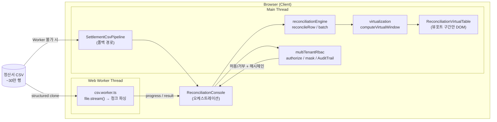
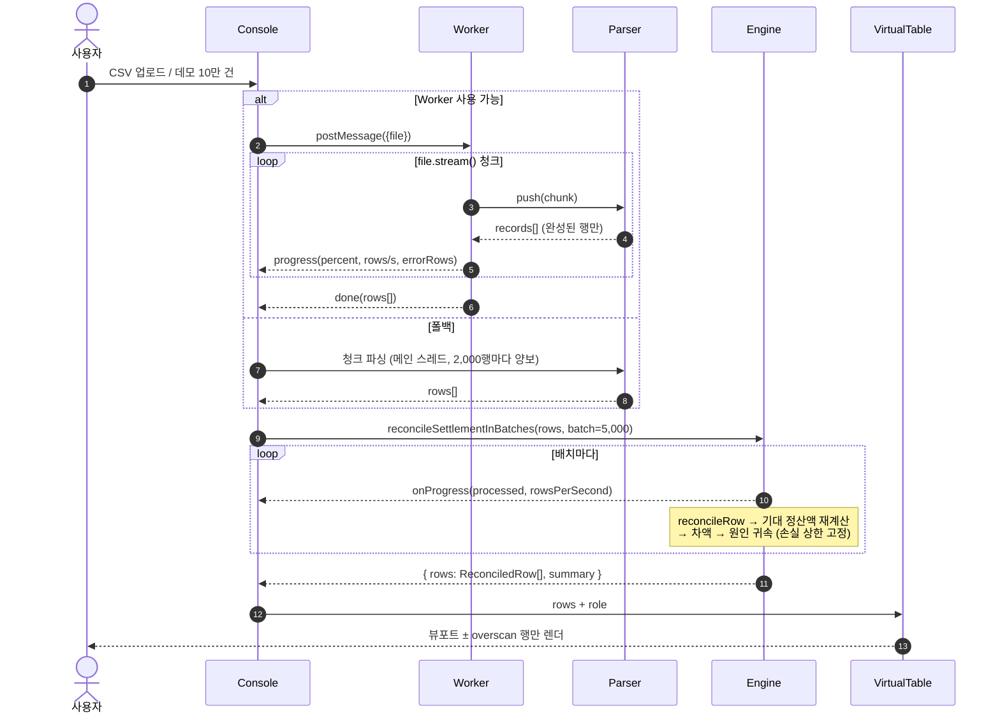
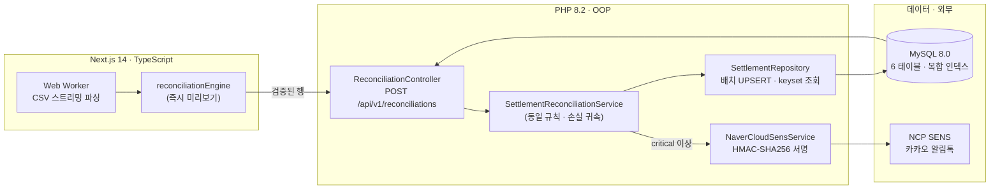
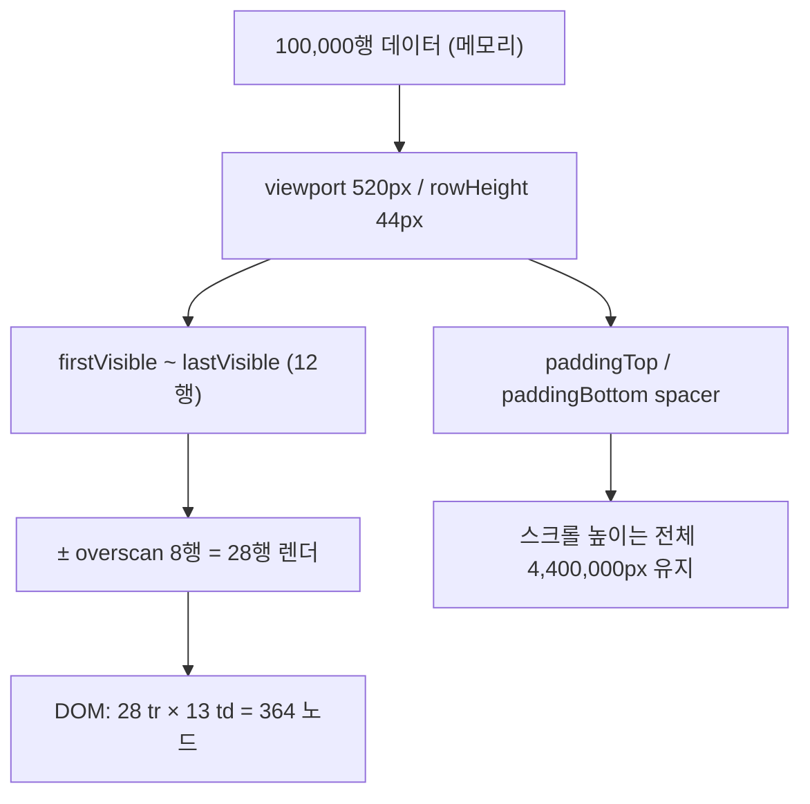
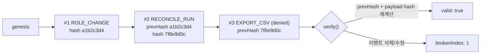

<div align="center">
  
</div>

<h1 align="center">SellerScope</h1>

<p align="center">
  이커머스 셀러를 위한 <strong>B2B 정산 대사 &amp; 이상 탐지 플랫폼</strong><br />
  <sub>10만 행 정산서 · Web Worker 파싱 · 가상화 렌더링 · 멀티 테넌트 RBAC · 해시체인 감사 로그</sub><br />
  <sub><strong>Full-Cycle</strong>: Next.js 14 프론트엔드 + PHP 8.2 백엔드 + MySQL 8.0 + 네이버클라우드 SENS 알림톡</sub>
</p>

<p align="center">
  <a href="https://nextjs.org"></a>
  <a href="https://www.typescriptlang.org"></a>
  <a href="https://tailwindcss.com"></a>
  <a href="https://vitest.dev"></a>
  <a href="https://www.php.net/releases/8.2/ko.php"></a>
  <a href="https://dev.mysql.com/doc/refman/8.0/en/"></a>
  <a href="https://api.ncloud-docs.com/docs/sens-alimtalk-send"></a>
  <a href="https://vercel.com/new/clone?repository-url=https%3A%2F%2Fgithub.com%2FShye-Seo%2Fcommerce-seller-analytics"></a>
</p>

> "이번 달 매출은 늘었는데, 통장에 들어온 돈은 왜 줄었지?"

이커머스 셀러가 실제로 돈을 잃는 지점은 **마진 계산**이 아니라 **정산서와 판매 원장이 어긋나는 순간**입니다.
마켓은 매월 정산서를 주고, 셀러는 그 숫자를 검증 없이 받아들입니다. SellerScope는 그 숫자를 **계약 조건으로 다시 계산**해서,
수수료 초과 청구·반품비 중복 차감·설명되지 않는 정산 부족을 **원인별 금액으로 증명**합니다.

- **라이브 콘솔**: `/reconciliation` — 배포 후 `https://<your-app>.vercel.app/reconciliation`
- **서버 계층**: `backend/` (PHP 8.2 OOP API·배치) + `database/` (MySQL 8.0 DDL·ERD) — §4.5, [ERD 설계서](database/ERD_SPEC.md)
- **마진 대시보드**: `/` — 판매 조건별 실시간 마진·마켓 비교·키워드 기회 분석 (기존 기능, 그대로 유지)

---

## 목차

1. [한눈에 보기](#1-한눈에-보기)
2. [문제 정의: 마진 계산기로는 부족한 이유](#2-문제-정의-마진-계산기로는-부족한-이유)
3. [콘솔 사용 흐름](#3-콘솔-사용-흐름)
4. [아키텍처](#4-아키텍처)
   - 4.5 [서버 계층: PHP 8.2 + MySQL 8.0 + 알림톡](#45-서버-계층--php-82--mysql-80--네이버클라우드-sens-알림톡)
5. [핵심 모듈 1 — 대사·이상 탐지 엔진](#5-핵심-모듈-1--대사이상-탐지-엔진)
6. [핵심 모듈 2 — Web Worker 스트리밍 파서](#6-핵심-모듈-2--web-worker-스트리밍-파서)
7. [핵심 모듈 3 — 10만 행 가상화 테이블](#7-핵심-모듈-3--10만-행-가상화-테이블)
8. [핵심 모듈 4 — 멀티 테넌트 RBAC & 감사 로그](#8-핵심-모듈-4--멀티-테넌트-rbac--감사-로그)
9. [기술적 트레이드오프](#9-기술적-트레이드오프)
10. [성능 측정](#10-성능-측정)
11. [테스트 전략](#11-테스트-전략)
12. [기존 기능: 마진 시뮬레이터 · 진단 · 마켓 비교](#12-기존-기능-마진-시뮬레이터--진단--마켓-비교)
13. [시작하기 · 배포](#13-시작하기--배포)
14. [한계와 다음 단계](#14-한계와-다음-단계)
15. [면접 예상 질문과 답](#15-면접-예상-질문과-답)
16. [작성자](#16-작성자)

---

## 1. 한눈에 보기

| # | 엔터프라이즈 기능 | 구현 | 검증 |
| --- | --- | --- | --- |
| 1 | 계약 기반 정산 대사 + 원인별 손실 귀속 | `src/lib/reconciliationEngine.ts` | 33 케이스 |
| 2 | 청크 스트리밍 파서 + Web Worker + 폴백 | `src/lib/csvStreamParser.ts`, `src/lib/settlementFileParser.ts`, `src/workers/csv.worker.ts` | 20 케이스 |
| 3 | 10만 행 가상화 테이블 (rAF 스로틀) | `src/lib/virtualization.ts`, `src/components/reconciliation/ReconciliationVirtualTable.tsx` | 16 케이스 |
| 4 | 멀티 테넌트 RBAC + 해시체인 감사 로그 | `src/lib/multiTenantRbac.ts`, `src/components/reconciliation/TenantSwitchConsole.tsx` | 22 케이스 |
| 5 | **PHP 8.2 백엔드 + MySQL 8.0 스키마 + SENS 알림톡** (정산 배치·이상 알림) | `backend/`, `database/schema.sql` | 75 케이스(MySQL 8.0 실연동 6건 포함) |
| 6 | **드래그앤드롭 파일 입구** — 검증 + 의존성 0 xlsx 파서(워커) | `src/lib/xlsxConvert.ts`, `src/lib/settlementUpload.ts`, `ReconciliationFileUploader.tsx` | 34 케이스 |
| 7 | **마켓 소명 리포트** — 플랫폼 규격 CSV + 인쇄용 PDF | `src/lib/reconciliationReport.ts`, `ReconciliationClaimPanel.tsx` | 28 케이스 |

**측정값 (이 컨테이너, Node 20.20.2 · 100,000행 기준)**

| 구간 | 결과 |
| --- | --- |
| CSV 직렬화 (12.98 MB) | 173 ms |
| 스트리밍 파싱 (따옴표·개행 포함) | **612 ms** (약 16.3만 행/s) |
| 대사 계산 (동기, 100k) | **161 ms** (약 62만 행/s) |
| 배치 대사 (5,000행 단위, 이벤트 루프 양보) | 193 ms |
| 이상 탐지 결과 | 정상 대사율 82.6% · 이상 17,396건 · 누수 5,389,043원 |

> 측정 재현: `npm test`에 포함된 5만 행 성능 케이스(`csvStreamParser.test.ts`)와 §10의 기준을 사용했습니다.
> 브라우저 실측치는 기기·스레드 수에 따라 달라지며, 이 저장소는 **측정 코드와 기준선**을 함께 남기는 쪽을 택했습니다.

---

## 2. 문제 정의: 마진 계산기로는 부족한 이유

### 2.1 셀러가 실제로 겪는 네 가지 어긋남

| 실제 상황 | 셀러가 겪는 일 | 이 프로젝트의 처리 |
| --- | --- | --- |
| 계약 수수료율 3.63%인데 청구는 4.1% | "이번 달 수수료가 왜 늘었지?" | 계약율로 기대 수수료를 재계산해 **초과분만** 귀속 |
| 반품 왕복 배송비 5,000원을 11,200원 차감 | 반품 한 건에 배송비를 두 번 냄 | 왕복 기준액 초과분을 **중복 차감**으로 분리 |
| 배송 완료 주문에 반품비 3,000원 | 반품 안 했는데 반품비 | **배송완료 건 반품비**로 탐지 |
| 수수료·배송·반품 어디에도 없는 1,500원 부족 | 마켓에 물어볼 근거가 없음 | **설명 불가 부족액**으로 남기고 금액을 특정 |

### 2.2 왜 "차액이 있다"로는 부족한가

정산 담당자가 마켓에 이의를 제기하려면 **"이 3,400원은 수수료 초과 1,900원 + 반품비 중복 1,500원"** 이라고 말할 수 있어야 합니다.
그래서 이 엔진은 차액을 계산하는 데서 멈추지 않고, **차액을 원인별로 나눠 갖게(attribution)** 합니다.

동시에 조심해야 할 것이 있습니다. 수수료 초과로 300원이 더 나갔고 그 결과 정산이 300원 부족하면, 그 300원을
"수수료 초과"와 "정산 부족"으로 **두 번 세면 안 됩니다.** 이 프로젝트는 행 단위 손실을 `기대 정산액 − 실제 정산액`의
양수분으로 **상한을 고정**하고, 원인 금액을 그 상한 안에서 배정합니다(§5.3).

### 2.3 규모가 곧 난이도다

3개월 치 정산서는 5만~30만 행, 13~15열, 13~20MB입니다.
`file.text()` + `split('\n')` + `map()`은 세 가지를 무너뜨립니다.

1. **메인 스레드 정지** — 파싱·매핑이 한 번에 돌면 UI가 수 초 얼어붙습니다.
2. **메모리** — 문자열 + 객체가 동시에 살아 있으면 모바일 탭이 OOM으로 죽습니다.
3. **DOM 폭증** — 10만 `<tr>` × 12열 = 120만 노드. 스크롤이 5fps가 됩니다.

이 세 문제를 각각 **Web Worker**, **청크 스트리밍**, **가상화**로 분리해 해결했습니다.

---

## 3. 콘솔 사용 흐름

```
1) /reconciliation 접속
   └ 데모 정산 원장 20,000건이 자동 로드되고, 배치 대사가 진행률과 함께 실행됨

2) 좌측 레일에서 컨텍스트 고정
   └ 법인(본사 / 부산 지사 / 위탁사) × 역할(대표 / 정산 담당자 / 운영 MD)
   └ 역할에 따라 정산액·원가가 마스킹되고, 권한 없는 동작은 감사 로그에 '거부'로 남음

3) 데이터 유입 — File intake 카드
   ├ "데모 2만 건" / "10만 건 스트레스" — 고정 시드 데모 원장 생성 + 배치 대사
   ├ 드래그앤드롭 업로더 — CSV · TSV · XLSX. 검증(0바이트/용량/가짜 xlsx) → Web Worker 파싱
   │  ├ 진행률 0~100% (엑셀은 변환 25% → 파싱 75%), 실행 경로·읽은 행·오류·중복·처리 속도 표시
   │  └ 실패는 사유 + 다음 행동("다시 내려받기", "기간을 나눠 업로드")으로 안내
   └ "샘플 양식" — 업로드 테스트용 500건 CSV (한글 헤더)

4) 탐색
   ├ 필터: 전체 / 역마진 / 수수료 오류 / 반품·배송 / 정산 차액
   ├ 검색: 주문번호 · 상품명 · SKU (useDeferredValue로 타이핑 블로킹 방지)
   ├ 행 클릭 → 상세 드로어: 기대값 vs 실제값, 원인별 귀속 금액, 계산식
   └ 키보드: ↑/↓ 이동, Enter 상세 열기

5) 반출 — Claim report 카드
   ├ "접수용 CSV" — 마켓 규격(스마트스토어 / 쿠팡 / 11번가·G마켓) 소명 요청 파일
   ├ "인쇄용 PDF" — A4 소명 요청서(브라우저 인쇄 → PDF 저장). 팝업 차단 시 HTML 저장으로 폴백
   ├ "이상 내역 CSV" — 전체 이상 내역(내부 공유용)
   └ "감사 로그 CSV" — audit.read 권한자만. 해시체인 무결성 배지 상시 표시
```

---

## 4. 아키텍처

### 4.1 시스템 구성



**경계 설계 원칙** — 계산(`lib`)은 DOM을 모르고, 렌더링(`components`)은 금액을 계산하지 않습니다.
그래서 대사·파싱·가상화·권한 로직 전부를 브라우저 없이 테스트할 수 있습니다(§11).

### 4.2 대사 파이프라인 (시퀀스)



### 4.3 디렉터리 구조

```
src/
├── app/
│   ├── page.tsx                    # 마진 대시보드 + Enterprise 진입 카드
│   ├── reconciliation/page.tsx     # 정산 대사 콘솔
│   └── layout.tsx
├── components/
│   ├── reconciliation/
│   │   ├── ReconciliationConsole.tsx        # 상태 오케스트레이션 (테넌트·역할·업로드·반출)
│   │   ├── TenantSwitchConsole.tsx          # 테넌트/역할 전환 + 권한 매트릭스 + 감사 로그
│   │   ├── ReconciliationVirtualTable.tsx   # 가상화 표 + 필터 + 키보드 탐색
│   │   └── SettlementDetailDrawer.tsx       # 1건 상세: 기대값/실제값/귀속/계산식
│   ├── EnterpriseEntry.tsx         # 홈의 엔터프라이즈 요약 (서버 컴포넌트, 빌드 시 실계산)
│   └── (기존) Dashboard, MarginSimulator, MarketComparisonMatrix …
├── lib/
│   ├── reconciliationEngine.ts     # 대사·이상 탐지·손실 귀속·집계
│   ├── csvStreamParser.ts          # 토크나이저 + 행 매퍼 + 파이프라인 + 진행률
│   ├── settlementFileParser.ts     # File → Worker/폴백 진입점
│   ├── csvWorkerProtocol.ts        # 워커 메시지 계약
│   ├── virtualization.ts           # 윈도 계산 (고정/가변, 이진 탐색)
│   ├── multiTenantRbac.ts          # 권한·마스킹·감사 로그(해시체인)
│   ├── settlementFixtures.ts       # 고정 시드 데모 원장 + CSV 직렬화
│   └── (기존) calculator, diagnostics, marketComparison, format, types
└── workers/
    └── csv.worker.ts               # 파싱 워커 (Next.js webpack이 별도 청크로 번들)
```

### 4.5 서버 계층 — PHP 8.2 · MySQL 8.0 · 네이버클라우드 SENS 알림톡

브라우저 콘솔은 "내가 올린 파일"만 봅니다. 운영에서는 마켓 4~5곳의 정산서가 매일 밤 자동으로
들어오고, 100만 행을 **배치로 다시 계산**해 결과를 DB에 남겨야 합니다. 탭이 닫히면 사라지는
계산은 감사 대상이 될 수 없습니다. 그래서 같은 도메인 규칙을 서버에 한 번 더 구현하고,
두 구현이 **같은 금액**을 내도록 테스트로 고정했습니다.



| 계층 | 무엇을 보장하나 |
| --- | --- |
| **DB (MySQL 8.0)** | 6개 테이블·FK·CHECK·복합 인덱스. 정산서 원본과 대사 결과를 한 행에서 대조하고, 원본 컬럼은 재계산이 덮어쓰지 않는다 |
| **배치 저장** | 250행 단위 `INSERT … AS new ON DUPLICATE KEY UPDATE`. 유니크 키가 멱등성을 보장(재업로드해도 행이 늘지 않음) |
| **이상 탐지** | 원인별 손실 귀속을 서버에서도 동일하게. `(order_id, anomaly_type)` 유니크로 중복 없음, 닫힌 이의 제기는 재대사로 되살아나지 않음 |
| **알림톡** | SENS HMAC-SHA256 서명 → 202 접수 → `messageStatusCode 0000` 도달 확인. 실패는 배치를 막지 않고 재시도 큐로 |
| **감사 로그** | 테넌트별 SHA-256 해시체인. 중간 행을 고치면 `verifyChain()`이 깨진 `seq`를 돌려준다 |

**실행**

```bash
docker compose up -d mysql                 # MySQL 8.0.40 + 스키마 + 데모 데이터
cd backend && composer install
php bin/migrate.php --fresh --seed --verify
php bin/reconcile.php --tenant=1 --file=examples/settlement_2026-10_sample.csv --verify
composer test                              # 75 tests (MySQL 있으면 실연동 6건 포함)
```

**문서**

- [`database/ERD_SPEC.md`](database/ERD_SPEC.md) — Mermaid ERD, 테이블 요약, 인덱싱 전략(브리프 지정
  `(tenant_id, settlement_date)` / `(store_id, anomaly_type)` 포함), 타입 선택 근거, 운영 쿼리 실행 계획
- [`backend/README.md`](backend/README.md) — API 계약, SENS 서명 함정 3가지, 멱등성·반올림·교착 재시도,
  테스트 목록과 운영 배치 방법

---

## 5. 핵심 모듈 1 — 대사·이상 탐지 엔진

### 5.1 데이터 계약

정산서에서 읽는 값과 셀러 원장에서 가져오는 값을 **한 행에서 분리**합니다.
두 출처를 섞으면 "마켓이 틀렸다"와 "내 원가가 틀렸다"를 구분할 수 없습니다.

| 필드 | 출처 | 의미 |
| --- | --- | --- |
| `paidAmount` | 마켓 | 소비자 결제금액 |
| `commission` | 마켓 | 청구된 판매 수수료 |
| `shippingDeduction` | 마켓 | 추가 차감 배송비 |
| `returnFee` | 마켓 | 차감 반품비 |
| `settledAmount` | 마켓 | 실제 입금 정산액 (차감 정산이면 음수) |
| `unitCost` | 셀러 원장 | 매입원가(개당) |
| `sellerShippingCost` | 셀러 원장 | 실제 부담 배송원가 |
| `contractFeeRate` | 계약 | 계약 판매 수수료율(%) |
| `status` | 마켓 | 배송완료 / 반품완료 / 취소 / 교환완료 |

### 5.2 탐지 규칙

| 코드 | 조건 | 손실 계산 | 심각도 |
| --- | --- | --- | --- |
| `FEE_OVERCHARGE` | 청구 > 계약 기대 + 허용오차 | 초과분 | critical |
| `FEE_UNDERCHARGE` | 청구 < 계약 기대 − 허용오차 | 0 (소급 위험) | info |
| `FEE_ON_CANCELED_ORDER` | 취소 주문에 수수료 > 0 | 전액 | critical |
| `SHIPPING_OVERCHARGE` | 차감 배송비 > 계약 배송비 | 초과분 | warning |
| `RETURN_FEE_DOUBLE_CHARGED` | 반품완료 + 반품비 > 왕복 기준액 | 기준액 초과분 | critical |
| `RETURN_FEE_ON_SHIPPED_ORDER` | 배송완료 + 반품비 > 0 | 반품비 | warning |
| `SETTLEMENT_SHORTFALL` | 원인으로 설명 안 되는 차액 > 10원 | 잔여 부족액 | critical |
| `ROUNDING_LEAK` | 잔여 차액 1~10원 | 잔여 | info |
| `SETTLEMENT_SURPLUS` | 실제 > 기대 | 0 (차감 위험) | info |
| `NEGATIVE_MARGIN` | 배송완료 + 정산액 < 원가+배송 | 0 (노출액으로 별도 집계) | critical |
| `MISSING_LEDGER` | 매입원가 ≤ 0 | 0 (검증 불가) | warning |

**허용오차 설계** — 수수료는 `max(100원, 기대 수수료 × 1%)`. 마켓별 반올림·프로모션 수수료 때문에 1~100원 차이는
이상으로 보지 않습니다. 정산 차액은 10원. **오탐은 신뢰를 죽이고, 미탐은 돈을 잃게 하므로** 둘의 기준을 분리했습니다.

### 5.3 손실 귀속 알고리즘 (이중 계산 금지)

```text
1. 계약 조건으로 기대값 재계산
   revenue           = 취소·반품 ? 0 : paidAmount
   expectedCommission = round(revenue × 계약수수료율 / 100)
   expectedShipping   = revenue ? 계약배송비 : 0
   expectedReturnFee  = 반품·교환 ? 왕복배송비 : 0
   expectedSettlement = revenue − expectedCommission − expectedShipping − expectedReturnFee

2. 부족분 상한
   shortfall = max(0, expectedSettlement − settledAmount)

3. 원인 후보 금액 계산 (수수료 초과 / 배송비 초과 / 반품비 초과 / 취소건 수수료)

4. 우선순위대로 shortfall에서 배정
   취소건 수수료 → 반품비 중복/배송완료 반품비 → 수수료 초과 → 배송비 초과
   각 원인 손실 = min(후보 금액, 남은 부족분)

5. 남은 금액
   > 10원 → SETTLEMENT_SHORTFALL (설명 불가)
   1~10원 → ROUNDING_LEAK
```

**불변식(테스트로 고정)** — 모든 행에서

```text
sum(원인별 손실) === shortfall === 이 행의 loss
```

즉 **어떤 원인 금액도 부족분을 넘지 않고, 부족분은 정확히 원인 합으로 설명**됩니다.
4,000행 데모에서 이 불변식을 전수 검증합니다(`reconciliationEngine.test.ts`).

### 5.4 예시 — 27,900원 스마트스토어 주문

| 항목 | 계약 기준 | 정산서 | 차액 |
| --- | --- | --- | --- |
| 수수료 (3.63%) | 1,013원 | **1,313원** | +300 |
| 배송비 | 3,000원 | 3,000원 | 0 |
| 반품비 | 0원 | 0원 | 0 |
| **정산액** | **23,887원** | **23,587원** | **−300** |

결과: `FEE_OVERCHARGE` 1건, 귀속 손실 300원. 실효 마진은 `23,587 − 12,800 − 2,800 = 7,987원(28.6%)`.

### 5.5 대사 결과 → 마켓 접수 문서 (소명 리포트)

대사가 "수수료 1,900원 초과"를 찾아도, 셀러가 돈을 돌려받으려면 **고객센터가 받는 형식**이어야 합니다.
`reconciliationReport.ts`가 그 변환을 담당하며, 정책을 코드로 못 박았습니다.

| 결정 | 왜 |
| --- | --- |
| 청구 가능 원인만 6종 (`FEE_OVERCHARGE`, `FEE_ON_CANCELED_ORDER`, `SHIPPING_OVERCHARGE`, `RETURN_FEE_DOUBLE_CHARGED`, `RETURN_FEE_ON_SHIPPED_ORDER`, `SETTLEMENT_SHORTFALL`) | 역마진은 계약 위반이 아니라 판매 조건 문제, 과소 청구는 오히려 소급 청구 위험, 반올림 누수는 건별 실익 없음. 섞으면 담당자가 전체를 반려합니다 |
| 금액 내림차순 + 하한 1,000원 + 상한 50건 | 문의 1건의 행정 비용이 1,000원을 넘고, 담당자는 상위 N건만 읽습니다(파레토) |
| 청구액 ≤ 해당 주문 부족분 | 대사 엔진의 귀속 금액을 **다시 계산하지 않고 합산**합니다. 같은 돈을 두 번 청구하지 않습니다 |
| 마켓별 3가지 규격 CSV | 스마트스토어(문의유형·스토어명·사업자번호·주문번호·차액), 쿠팡(WING 업체코드·정산월), 11번가·G마켓 통합 양식 |
| UTF-8 BOM + CRLF + 수식 인젝션 방지 | 한국어 엑셀에서 깨지지 않고, 상품명 셀의 `=HYPERLINK(...)`가 담당자 PC에서 실행되지 않습니다 |
| 인쇄용 A4 HTML | 브라우저 인쇄 엔진으로 PDF를 만듭니다. PDF 라이브러리·폰트 임베딩·서버 없이 같은 결과(의존성 0) |

`buildClaimReport()`는 순수 함수라서 "우리 8건 중 5,600원이 청구 가능하고, 역마진 3건은 청구 대상이 아니다"를
테스트로 고정할 수 있습니다. 반출은 `export.csv` 권한을 통과해야 하고, 내려받은 파일명과 금액이 감사 로그에 남습니다.

---

## 6. 핵심 모듈 2 — Web Worker 스트리밍 파서

### 6.1 청크 경계에서 상태를 잃지 않는 토크나이저

가장 흔한 버그는 **청크가 따옴표 중간에서 끊기는 경우**입니다.
`"서울, 강남"` 7글자를 4글자씩 자르면 `"서울`, `, 강`, `남"`이 되어 필드가 깨집니다.
`CsvTokenizer`는 다음 상태를 청크 사이에 유지합니다.

```text
fields        현재까지 완성된 필드
field         진행 중인 필드
inQuotes      따옴표 안인가
pendingQuote  청크가 '"' 바로 뒤에서 끝났는가 ("" 이스케이프인지 닫는 따옴표인지 미정)
lineNumber    원본 행 번호 (오류 보고용)
bomStripped   UTF-8 BOM 제거 여부
corrupted     필드 길이 초과(64KB) — 해당 행만 격리
```

`pendingQuote`가 핵심입니다. 이 상태가 없으면 `"a""b"` 같은 값이 청크 경계에서 깨집니다.
테스트는 **7글자 단위로 자른 입력**과 원본 입력의 파싱 결과가 완전히 같은지 확인합니다.

### 6.2 행 단위 오류 격리

실무 정산서는 항상 몇 행이 깨져 있습니다. 한 행 때문에 30만 행을 버릴 수는 없습니다.

| 실패 유형 | 처리 |
| --- | --- |
| 필수 열 누락 | `SettlementCsvSchemaError` — 파일 전체 거부 (조용히 0건 처리하면 더 위험) |
| 금액 형식 오류 | 해당 행만 오류 격리, 사유·행번호·원본값 40자 보관 |
| 알 수 없는 채널/상태 | 해당 행만 격리 |
| 중복 주문번호 | 두 번째 행부터 제외 (정산 2회 계산 방지) |
| 빈 행 | 무시 |

격리된 오류는 최대 200건 샘플을 UI에 보여 주고, 전체 건수는 따로 셉니다.

### 6.3 두 개의 실행 경로

```text
parseSettlementFile(file)
├── Worker 사용 가능 → csv.worker.ts
│   └ file.stream() → TextDecoder(stream) → pipeline.push(chunk)
│     메인 스레드는 파일을 읽지도, 파싱하지도 않는다
└── Worker 실패/불가 → 메인 스레드 폴백
    └ 같은 파이프라인을 2,000행마다 setTimeout(0)으로 양보
      meta.engine = "main-thread", engineFallbackReason = 실제 사유
```

**폴백을 숨기지 않습니다.** 어느 경로로 처리됐는지 UI에 표시합니다. 조용히 느려지는 것이 가장 나쁜 실패입니다.

### 6.4 헤더 별칭

마켓마다 같은 값을 다르게 부릅니다(`마켓수수료` / `판매수수료` / `수수료`, `실정산액` / `정산금액` / `입금액`).
`HEADER_ALIASES` 표 하나에 모아 두어 **새 마켓 정산서는 이 표만 늘리면** 붙습니다.
필수 열은 `주문번호 · 채널 · 결제금액 · 실정산액`이며, `계약수수료율`이 없으면 실효 수수료율로 대체합니다.

### 6.5 엑셀(.xlsx)을 그대로 받는 입구 — 의존성 0

셀러가 마켓에서 내려받는 정산서는 대부분 **엑셀 파일**입니다. "CSV로 저장해서 올려 주세요"는 실무에서 제품이 죽는 지점이라,
xlsx를 직접 읽습니다. xlsx는 ZIP + XML이므로 라이브러리 없이 필요한 부분만 구현했습니다.

```text
업로드 → validateUploadFile()            0바이트 · 50MB 상한 · 확장자 · ZIP 매직바이트(가짜 xlsx 차단)
       → csv.worker.ts 안에서
           ① ZIP 중앙 디렉터리 → xl/worksheets/sheet1.xml, sharedStrings.xml, styles.xml 해제
              (DecompressionStream("deflate-raw"), stored/deflate 모두 지원)
           ② 셀 참조(A1→0, AA→26) 복원, 빈 셀 자리 유지, sharedStrings/인라인 문자열 결합
           ③ 날짜 서식(numFmt 14~22, 45~47, 사용자 "yyyy-mm-dd")이면 일련번호 → YYYY-MM-DD
              (1900년 윤년 버그 보정 포함 — 이걸 빼면 주문일이 45678로 들어옵니다)
           ④ CSV 문자열로 직렬화 → 기존 파이프라인에 그대로 투입
```

- 변환은 워커에서 하므로 10만 행 엑셀을 풀어도 화면이 멈추지 않습니다. 진행률은 **변환 0~25% / 파싱 25~100%** 로 이어집니다.
- 파서를 두 벌 유지하지 않습니다. 변환 결과가 CSV이므로 행 매퍼·대사 엔진·오류 격리는 CSV 경로와 완전히 동일합니다.
- 구형 `.xls`(BIFF)는 ZIP이 아니라서 지원하지 않으며, **거절 사유와 함께 "Excel 통합 문서(.xlsx) 또는 CSV UTF-8로 저장"** 을 안내합니다.
- 다운로드 실패로 저장된 HTML 오류 페이지를 `.xlsx`로 올리는 경우가 흔해서, ZIP 매직바이트까지 확인합니다.

---

## 7. 핵심 모듈 3 — 10만 행 가상화 테이블

### 7.1 계산

고정 행 높이(44px) 기준, 뷰포트에 보이는 구간만 계산합니다. **O(1)**.

```text
firstVisible = floor(scrollTop / rowHeight)
visibleCount = ceil(viewportHeight / rowHeight)
startIndex   = clamp(firstVisible − overscan, 0, rowCount)
endIndex     = clamp(firstVisible + visibleCount + overscan, 0, rowCount)
paddingTop   = startIndex × rowHeight
paddingBottom= totalHeight − endIndex × rowHeight
```

- `scrollTop`이 음수(iOS 러버밴드)이거나 최대치를 넘어도 인덱스가 범위를 벗어나지 않습니다.
- `rowHeight`가 0이면 1로 보정해 무한 루프를 막습니다.
- 가변 높이(메모/드로어)는 **누적 합 배열 + 이진 탐색**(O(log n))으로 처리합니다.

### 7.2 렌더 예산

- 스크롤 이벤트는 `requestAnimationFrame`으로 묶어 **프레임당 1회**만 상태를 갱신
- 위/아래는 `<tr style={{height: padding}}>` spacer로 대체 (레이아웃은 유지, DOM은 안 만듦)
- 실제 DOM 셀 수를 화면 하단에 표시: `10만 행 × 13열 = 1,300,000` → **390개** (약 3,300배 절감)



### 7.3 필터·검색

- 필터 5종은 `matchesFilter`(순수 함수)로 판정하고, 건수 배지를 함께 계산합니다.
- 검색은 `useDeferredValue`로 지연시켜 10만 행 필터링이 타이핑을 막지 않게 합니다.
- 키보드 `↑/↓`는 활성 인덱스와 스크롤을 함께 이동시켜, 스크롤 없이 행을 훑을 수 있습니다.

---

## 8. 핵심 모듈 4 — 멀티 테넌트 RBAC & 감사 로그

### 8.1 테넌트 계층

| 테넌트 | 유형 | 사업자번호 | 정산 주기 |
| --- | --- | --- | --- |
| 본사 스토어 (주식회사 숭구리커머스) | HQ | 123-45-67890 | 월 1회 · 익월 10일 |
| 부산 지사 (문현 물류센터) | BRANCH | 234-56-78901 | 월 2회 · 10/25일 |
| 위탁사 (협력 셀러 12곳) | CONSIGNMENT | 345-67-89012 | 월 1회 · 익월 15일 |

테넌트를 바꾸면 **정산 원장 자체가 달라집니다**(테넌트 id에서 시드를 파생). 숫자만 가리는 척하지 않습니다.

### 8.2 권한 매트릭스

| 권한 | 대표 관리자 | 정산 담당자 | 운영 MD |
| --- | --- | --- | --- |
| 법인 전환 | ● | － | － |
| 정산 금액 열람 | ● | ● | － |
| 마스킹된 정산 금액 | － | － | ● |
| 매입원가 열람 | ● | ● | － |
| CSV 반출 | ● | ● | － |
| 대사 실행 | ● | ● | ● |
| 감사 로그 열람 | ● | － | － |
| 구성원 관리 | ● | － | － |

권한은 **열거(allow-list)** 방식입니다. 새 화면·새 동작을 추가할 때 목록에 없으면 기본이 거부입니다.
`authorize()`는 허용 여부뿐 아니라 **거부 사유 문장**을 돌려주어, UI가 그대로 안내에 씁니다.

```ts
authorize({ role: "SETTLEMENT_MANAGER", activeTenantId: "tn-busan", targetTenantId: "tn-partner", action: "settlement.amount" })
// → { allowed: false, code: "TENANT_OUT_OF_SCOPE",
//     reason: "정산 담당자는 위탁사 (협력 셀러 12곳) 데이터에 접근할 수 없습니다. 소속 법인 데이터만 열람합니다." }
```

### 8.3 마스킹 정책

| 수준 | 표기 | 노출 정보 |
| --- | --- | --- |
| `none` | `1,234,567원` | 전체 |
| `partial` | `₩ 1,***,***` | 자릿수 규모만 (정확한 값 복원 불가) |
| `full` | `₩ ●●●●●` | 없음 (숫자 0개) |

사업자번호는 `123-**-***90`, 원가는 MD에게 완전 차단입니다.
**마스킹은 표시 계층에서만** 일어나고 원본 데이터는 변경되지 않습니다.

### 8.4 해시체인 감사 로그



- 이벤트마다 `seq · at · role · tenantId · action · target · detail · outcome · prevHash`를 FNV-1a로 해시
- 중간 이벤트를 지우면 다음 이벤트의 `prevHash`가 끊어져 **깨진 위치**를 반환
- **거부된 시도도 기록**합니다. "누가 반출하려다 막혔는가"가 감사에서 가장 중요한 정보다
- 해시체인은 블록체인이 아니라 **변조 흔적을 남기는 가벼운 장치**입니다. 서버 서명·append-only 저장은 §14 로드맵.

---

## 9. 기술적 트레이드오프

### 9.1 Web Worker vs 메인 스레드

| | Web Worker | 메인 스레드 (청크 + 양보) |
| --- | --- | --- |
| UI 반응성 | 완전 독립 (60fps 유지) | 파싱 중 프레임 드랍 가능 |
| 메모리 | 워커 힙에서 소비, 메인 힙 영향 없음 | 메인 힙에 그대로 |
| 복잡도 | 메시지 규약·에러 전파·번들 설정 | 단순 |
| 호환성 | CSP·구형 브라우저에서 차단 가능 | 항상 동작 |
| 파일 전달 | `File` 구조적 복제(복사 아님, 원본 유지) | 직접 읽기 |

**결론: 둘 다 구현하고, Worker를 기본으로 하되 폴백을 남겼습니다.** 폴백 사유를 UI에 노출해
"느린데 이유를 모르는" 상태를 만들지 않습니다.

### 9.2 가상화 vs 페이지네이션

| | 가상화 | 페이지네이션 |
| --- | --- | --- |
| 스크롤 감 | 끊김 없음 (전체 4,400,000px) | 20건 단위로 끊김 |
| DOM | 뷰포트+overscan만 | 한 페이지 |
| 구현 | 인덱스 계산·측정 필요 | 서버 쿼리만 있으면 쉬움 |
| 정산 탐색 적합성 | "이상 건을 훑는다"에 적합 | "특정 주문을 찾는다"에 적합 |

정산 대사는 **훑어보며 이상 패턴을 찾는** 작업이라 가상화를 선택했습니다. 검색은 별도로 제공합니다.

### 9.3 클라이언트 규칙 엔진 vs LLM

이상 탐지는 **결정적 규칙**입니다. LLM을 쓰면 세 가지가 무너집니다.

1. **금액 근거 추적 불가** — "왜 300원?"에 대해 재현 가능한 계산식을 줘야 함
2. **하이드레이션 결정성** — 같은 파일이 매번 다른 결과면 감사 로그가 무의미
3. **키·비용·지연** — 정적 배포에 비밀 키를 넣을 수 없고, 30만 행을 API로 보낼 수 없음

LLM이 유용한 지점은 따로 있습니다: "이 이상 패턴의 업계 관행" 같은 **설명 생성**. 규칙 엔진이 사실을 만들고,
LLM이 문장을 다듬는 구조가 맞습니다.

### 9.4 브라우저 대사 vs 서버 배치

| | 브라우저 (현재) | 서버 배치 |
| --- | --- | --- |
| 데이터 반출 | 파일이 기기를 떠나지 않음 (보안 유리) | 업로드 필요 |
| 규모 | 10만 건까지 쾌적 (측정) | 수백만 건 가능 |
| 권한 강제 | 클라이언트 (데모) | 서버 세션·RLS로 강제 |
| 재현성 | 세션 한정 | 스케줄·이력·알림 가능 |

**현재 구현은 "셀러가 자기 정산서를 자기 브라우저에서 검증"하는 시나리오에 최적화**되어 있습니다.
B2B SaaS로 판매하려면 서버 영속화와 서버 측 권한 강제가 필요하며, §14에 그 경계를 적었습니다.

### 9.5 계약 프리셋 vs 계약 DB

데모는 마켓별 공개 수수료 정책을 프리셋으로 둡니다. 실무에서는 **계약서 값이 법인·카테고리·기간별로 다르므로**
계약 테이블이 필요합니다. 엔진은 이미 `contracts` 주입을 지원해, 프리셋 대신 계약 DB 값을 넣으면 그대로 동작합니다
(`reconcileSettlement(rows, { contracts })` — 테스트로 검증).

---

## 10. 성능 측정

**환경** — 이 컨테이너, Node 20.20.2, 100,000행 / 15열 / 12.98MB CSV, 고정 시드.

| 구간 | 측정 | 비고 |
| --- | --- | --- |
| CSV 직렬화 | 173 ms | 테스트 픽스처 생성 |
| 스트리밍 파싱 | **612 ms** | 64KB 청크, 따옴표·개행·중복 처리 포함 |
| 대사 계산 (동기) | **161 ms** | 100,000행, 힙 증가 약 32MB |
| 대사 계산 (배치 5,000) | **193 ms** | 이벤트 루프 양보 포함 |
| 결과 | 정상 82.6% · 이상 17,396건 | 누수 5,389,043원 · 역마진 노출 40,214,477원 |

| 렌더링 | 값 |
| --- | --- |
| 전체 렌더 시 DOM 셀 | 1,300,000 |
| 가상화 렌더 DOM 셀 | 364~390 (뷰포트 520px 기준) |
| 절감 배수 | 약 3,300배 |

**측정을 테스트에 넣은 이유** — 성능은 리팩터링으로 조용히 나빠집니다.
`csvStreamParser.test.ts`는 5만 행 파싱이 8초를 넘으면 실패합니다(로컬 측정의 약 13배 여유 — CI 머신 편차 허용).

---

## 11. 테스트 전략

**211 케이스 / 10 파일 / Vitest (`environment: node`)**

| 파일 | 케이스 | 검증 |
| --- | --- | --- |
| `reconciliationEngine.test.ts` | 33 | 정상 대사, 수수료 초과/과소, 취소건 수수료, 배송비 초과, 반품비 중복, 배송완료 반품비, 설명 불가 부족, 반올림 누수, 초과 입금, 역마진, 원장 누락, **이중 계산 금지 불변식**, 요약·채널 분해·상위 SKU, 커스텀 계약, 배치 진행률/중단, 4,000행 전수 불변식 |
| `csvStreamParser.test.ts` | 20 | 금액/율/날짜 파서, 따옴표·개행·`""` 이스케이프, 청크 경계(7글자 분할), BOM·CRLF, 필드 길이 초과, 별칭 헤더, 필수 열 누락, 행 격리, 중복 주문, 진행률, **CSV 왕복 동일성**, 5만 행 성능 |
| `virtualization.test.ts` | 16 | 고정 윈도 계산, overscan 클램프, 음수/초과 스크롤, 0 높이 보정, 누적 합, 이진 탐색, 가변 높이, DOM 절감 계산 |
| `multiTenantRbac.test.ts` | 22 | 역할 권한, 테넌트 범위 거부, 마스킹 3단계, 사업자번호, 필드별 마스크, 감사 로그 체인, 변조·삭제 탐지, 거부 기록, CSV 반출 권한 |
| `reconciliationReport.test.ts` | 28 | 청구 대상 선별(역마진·과소청구 제외), 금액 하한/상한, 정렬·플랫폼 분해, 원인별 합계 = 총액, CSV BOM·CRLF·인용·**수식 인젝션 방지**, 플랫폼별 규격 열, 인쇄 HTML 이스케이프 |
| `xlsxConvert.test.ts` | 20 | ZIP 중앙 디렉터리, stored/deflate, sharedStrings·인라인 문자열, 빈 셀 열 정렬, 날짜 서식 판정과 일련번호 변환, 1900 윤년 보정, 가짜 ZIP 거절, **변환 CSV → 대사 파이프라인 종단 검증** |
| `settlementUpload.test.ts` | 14 | 0바이트·상한 초과·확장자·가짜 xlsx·구형 xls 거절 사유, 경고 임계값, accept 속성 |
| `calculator.test.ts` | 22 | (기존) 수수료·마진·BEP·키워드 점수·포맷 |
| `diagnostics.test.ts` | 23 | (기존) 4축 진단·비용 비율·액션 플랜 |
| `marketComparison.test.ts` | 13 | (기존) 5개 마켓 비교·배지·순위 |

```bash
npm run typecheck   # tsc --noEmit
npm run lint        # next lint
npm test            # vitest run (211)
npm run build       # next build (프로덕션 번들 + 타입 검사)
```

**테스트 철학** — UI 스냅샷 대신 **도메인 불변식**을 고정합니다.
특히 "원인별 손실 합 = 부족분"은 화면이 아니라 회계 규칙이므로, 계산식을 바꾸면 반드시 테스트가 깨져야 합니다.

---

## 12. 기존 기능: 마진 시뮬레이터 · 진단 · 마켓 비교

루트(`/`) 대시보드는 그대로 유지됩니다. 정산 대사가 "사후 검증"이라면, 이쪽은 "사전 설계"입니다.

| 기능 | 내용 |
| --- | --- |
| 실시간 마진 시뮬레이터 | 판매가·원가·수수료·배송·광고·반품률 입력 → 건당 순이익·마진율·BEP 판매가·BEP 판매량 즉시 계산 |
| 마켓별 수수료 프리셋 | 스마트스토어 3.63% / 쿠팡 10.8% / 11번가 9% / G마켓 8.5% / 자사몰 PG 3.3% |
| AI 마진 진단 (규칙 기반) | 4축 점수(마진율 45 · 광고효율 20 · 반품안정성 15 · 고정비회수 20) + 실행 순서가 있는 액션 플랜 4종 |
| 5대 마켓 비교 매트릭스 | 동일 상품 조건에서 채널별 순이익·마진율·정산 주기 비교, Best Margin / Fast Settlement 배지 |
| 키워드 기회 분석 | 검색량·경쟁강도·구매의도를 합성한 0~100 기회 지수 |
| 매출·마진 추이 | 일별 30일 / 월별 12개월 매출(막대) + 마진율(선) |

> 진단은 외부 LLM 호출이 없는 **규칙 기반 엔진**입니다. 화면에도 "규칙 기반 진단 엔진"으로 표기해 과장하지 않았습니다.

---

## 13. 시작하기 · 배포

### 요구사항

- Node.js 18.17 이상 (개발·검증은 20.20.2)
- npm 9 이상

### 설치와 실행

```bash
npm install
npm run dev          # http://localhost:3000  (콘솔: /reconciliation)
npm test             # 211 tests
npm run build && npm start
```

### 서버 계층(선택)

프론트엔드만으로도 콘솔은 완전히 동작합니다. 정산 배치·DB 적재·알림톡까지 보려면:

```bash
docker compose up -d mysql
cd backend && composer install && php bin/migrate.php --fresh --seed
php bin/reconcile.php --tenant=1 --file=examples/settlement_2026-10_sample.csv --verify
composer test        # 75 tests
```

### Vercel 원클릭 배포

[](https://vercel.com/new/clone?repository-url=https%3A%2F%2Fgithub.com%2FShye-Seo%2Fcommerce-seller-analytics&project-name=commerce-seller-analytics&repository-name=commerce-seller-analytics)

- 환경변수·API 키가 필요 없습니다 (모든 계산은 브라우저에서, 데모 데이터는 고정 시드)
- Next.js 프리셋이 자동 감지되고, `main` 연결 시 이후 푸시마다 자동 배포됩니다
- 발급된 `*.vercel.app` 주소를 이력서·노션에 라이브 데모로 기재

---

## 14. 한계와 다음 단계

**지금 구현된 것과, 실서비스에서 더 필요한 것**

| 영역 | 현재 | 실서비스에 필요 |
| --- | --- | --- |
| 권한 | 클라이언트 RBAC (데모·시뮬레이터) | 서버 세션 + DB RLS(행 수준 보안)로 **서버 강제** |
| 데이터 | 파일 업로드 + 고정 시드 데모 | 마켓 API 연동, 정산 이력 저장, 재대사 |
| 감사 로그 | 브라우저 메모리 + 해시체인 | append-only 저장(WORM), 서버 서명, 보존 정책 |
| 계약 | 채널별 프리셋 | 법인·카테고리·기간별 계약 테이블 |
| 규모 | 브라우저 10만 건 | 서버 배치(수백만 건), 스트리밍 리포트 |
| 알림 | 화면 내 표시 | 손실 임계치 초과 시 메일·슬랙 알림 |

> **중요**: 이 저장소의 RBAC은 **포트폴리오용 시뮬레이터**입니다. 클라이언트 권한 검사는 UX이지 보안 경계가 아닙니다.
> 실서비스에서는 반드시 서버에서 같은 규칙을 강제해야 하며, `multiTenantRbac.ts`의 규칙을 공유 모듈로 서버에 올리는 것이
> 다음 단계입니다. 이 한계를 숨기지 않고 적어 두는 것이, 아키텍처를 이해하고 있다는 증거라고 생각합니다.

**로드맵**

- [x] 계약 기반 정산 대사 + 원인별 손실 귀속
- [x] Web Worker 청크 파싱 + 메인 스레드 폴백
- [x] 10만 행 가변/고정 가상화
- [x] 멀티 테넌트 RBAC + 해시체인 감사 로그
- [x] 마진 시뮬레이터·진단·마켓 비교 (1차)
- [x] 서버 영속화 (MySQL 8.0 6개 테이블 스키마 + Modern PHP 8.2 대사/이상탐지 API)
- [x] 네이버클라우드 SENS 알림톡 연동 (정산 이상 징후 알림 발송)
- [x] 의존성 제로 순수 엑셀 파서(XLSX) 및 마켓별 규격 소명 리포트(CSV/인쇄용 PDF) 다운로드
- [ ] 마켓 정산 실시간 API 연동 (스마트스토어 커머스API / 쿠팡 Open API Sandbox)
- [ ] Playwright 브라우저 E2E 테스트 슈트 (파일 업로드 → 대사 검증 → 리포트 다운로드)

---

## 15. 면접 예상 질문과 답

**Q. 왜 Web Worker를 썼고, 없으면 어떻게 되나?**
A. 파싱·매핑은 CPU 집약 작업이라 메인 스레드에서 돌면 입력·스크롤이 멈춥니다. `file.stream()`을 워커에서 청크로 읽어
메인 스레드는 진행률만 받습니다. CSP나 구형 브라우저로 워커가 막히면 같은 파이프라인을 2,000행마다 양보하며
메인 스레드에서 돌리고, **폴백 사유를 UI에 표시**합니다.

**Q. 10만 행을 어떻게 버벅임 없이 그렸나?**
A. 뷰포트에 걸친 행 + overscan만 DOM에 올립니다(약 28행). 위/아래는 spacer 높이로 대체해 스크롤 높이는 유지합니다.
스크롤은 rAF로 프레임당 1회만 상태를 갱신합니다. 결과적으로 DOM 셀이 130만 → 390개가 됩니다.

**Q. 손실액이 부풀지 않는다는 걸 어떻게 보장하나?**
A. 행마다 `shortfall = max(0, 기대 − 실제)`를 상한으로 두고, 원인별 금액을 그 안에서 배정합니다. 남은 금액은
`SETTLEMENT_SHORTFALL` 또는 `ROUNDING_LEAK`로 분리합니다. 4,000행 전수에 대해 `sum(원인 손실) === shortfall`을
테스트로 고정했습니다.

**Q. RBAC을 클라이언트에서 하면 보안이 아니지 않나?**
A. 맞습니다. 그래서 코드와 README 양쪽에 **시뮬레이터**라고 명시했습니다. 권한 규칙을 UI 밖 순수 모듈로 분리해
서버에서 같은 모듈을 재사용할 수 있게 만든 것이 이 구현의 목적이고, 실제 강제는 RLS·세션 기반으로 서버에서 해야 합니다.

**Q. 왜 TanStack Virtual 같은 라이브러리를 쓰지 않았나?**
A. 의존성 0개를 유지하면서 윈도 계산을 직접 검증하고 싶었습니다. 계산이 40줄 남짓이고, 이진 탐색·클램프 같은
경계 조건을 테스트로 고정하는 편이 라이브러리 옵션을 해석하는 것보다 이 프로젝트에 유리했습니다.
(가변 높이·동적 측정이 복잡해지면 라이브러리로 교체하는 것이 맞습니다.)

---

## 16. 작성자

**서승혜 (Seunghye Seo)** — Frontend & Fullstack Engineer (4년 차)  
GitHub [@Shye-Seo](https://github.com/Shye-Seo) · tjtmdgp95@gmail.com · 정보처리기사

### 주요 실무 경력 (주식회사 채티스 · 커머스 SaaS 셀링스톰)
이커머스 자동화 솔루션(SellingStorm) 기획·개발팀에서 프론트엔드(TypeScript, Tailwind)부터 백엔드(Modern PHP), DB 모델링(MySQL Workbench), 외부 연동까지 **서비스 1인 풀사이클을 주도 완주**했습니다.
- **아임웹 앱스토어 OAuth 2.0 온보딩**: 이커머스 입점 셀러의 무중단 계정 연동 및 웹훅 기반 구독·해지 라이프사이클 파이프라인 설계
- **상세페이지 임베디드 위젯 SDK**: 자사몰·스마트스토어 상세페이지용 초경량 반응형 위젯 SDK 개발 및 크롤러 방어(`X-Robots-Tag: noindex`) 최적화
- **멀티 테넌트 쿼터 관리 백오피스**: 테넌트별 API 호출량 및 플랜별 리소스 사용량을 격리 제어하는 쿼터(Quota) 관리 시스템 구축
- **대외 서비스 연동 & DB 설계**: 네이버클라우드 SENS 알림톡 및 인스타그램 Graph API 연동, MySQL 8.0 EER 스키마 설계 및 성능 튜닝

> 셀러가 정산서를 받고 나서야 손해를 알아차리는 일을 없애고 싶어서 시작한 프로젝트입니다.
> 마진 계산에서 출발해, 이제는 **정산서가 틀렸다는 사실을 금액으로 증명하는 도구**가 되었습니다.
