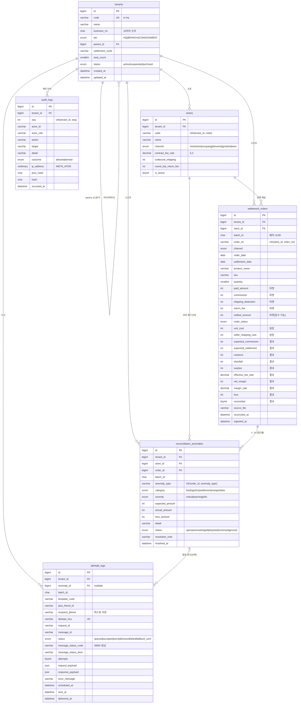
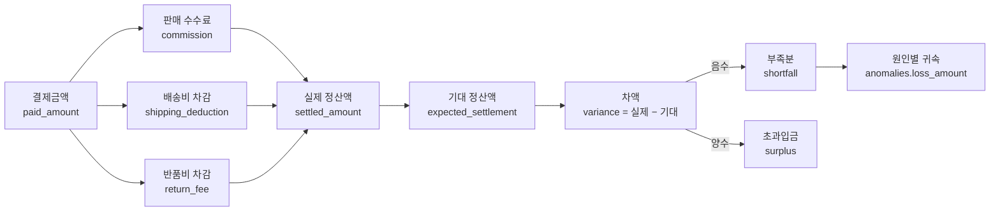
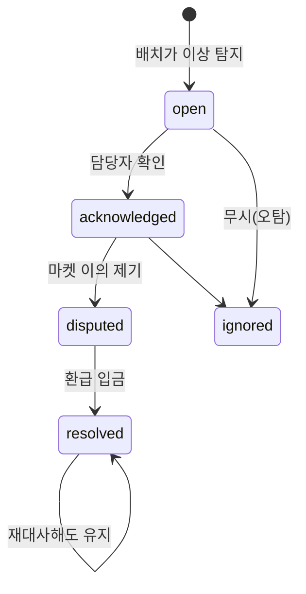
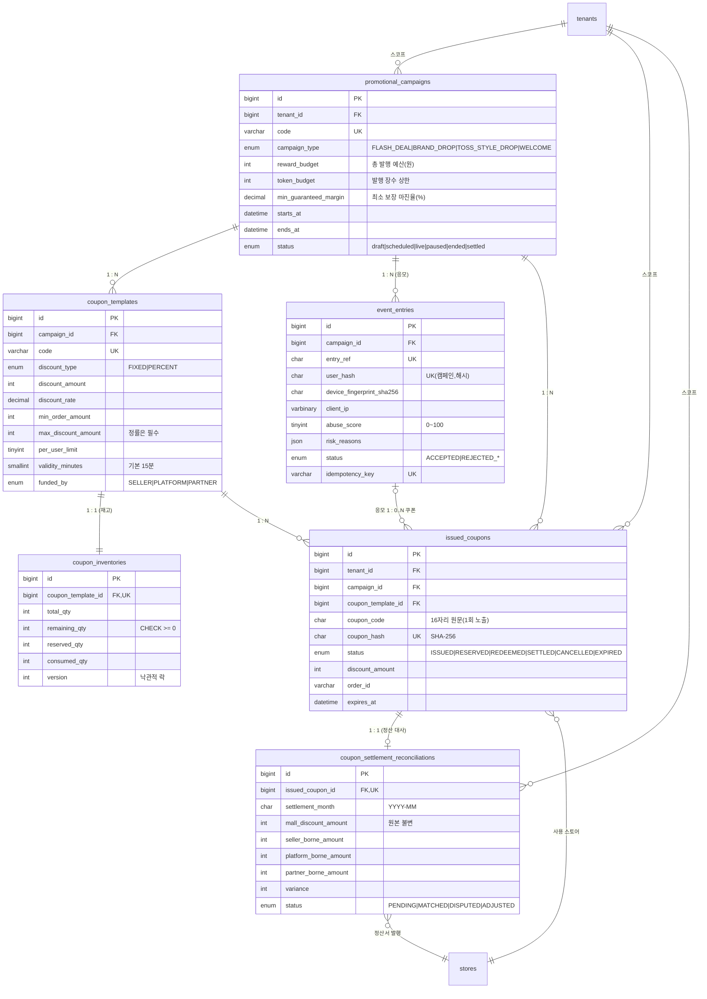

# SellerScope · DB ERD 및 물리 모델 설계서

> 대상 DBMS: **MySQL 8.0.19+** (InnoDB, `utf8mb4_0900_ai_ci`)
> 모델링 도구: **MySQL Workbench 8.0** — `database/schema.sql`을 `File > Import > Reverse Engineer`로
> 읽히면 이 문서의 EER 다이어그램과 같은 구조가 나옵니다. 반대 방향(EER → Forward Engineer)으로
> 스키마를 다시 뽑을 때도 이 문서의 제약(유니크 키·FK·CHECK)이 그대로 유지되는 것이 목표입니다.

---

## 1. 무엇을 모델링했나

이커머스 셀러의 **정산 대사(reconciliation)** 도메인입니다. 마켓 4~5곳이 매월 보내는 정산서와
셀러 원장(매입원가·실배송원가)을 한 행에서 만나게 하고, 계약 조건으로 기대 정산액을 다시 계산해
차액의 원인을 금액으로 귀속시킵니다.

핵심 요구는 네 가지였고, 테이블 수(6개)는 그 결과입니다.

| 요구 | 설계 답 | 테이블 |
| --- | --- | --- |
| 멀티 테넌트 격리(본사·지사·위탁사) | 테넌트 트리 + 모든 업무 테이블의 `tenant_id` 선행 | `tenants` |
| 채널별 계약 조건(수수료율·배송비) | 스토어에 계약을 붙임(테넌트 속성이 아님) | `stores` |
| 정산서 원본 + 원가 원장 + 대사 결과 | 한 행에 원본/결과 컬럼 분리(원본 불변) | `settlement_orders` |
| 원인별 손실 귀속(1주문 : N원인) | 유니크 (order_id, anomaly_type)로 멱등 | `reconciliation_anomalies` |
| 알림톡 발송·도달 추적 | 요청/건별/수신 상태 3단 + dedupe 키 | `alimtalk_logs` |
| 감사 로그(누가 어떤 금액을 봤나) | 테넌트별 해시체인(seq + prev_hash) | `audit_logs` |

일부러 만들지 않은 테이블도 있습니다.
- **`roles` / `permissions`**: 역할은 3종 고정(대표·정산·MD)이고 권한은 코드(enum)가 갖습니다.
  테이블로 빼면 3행짜리 테이블과 조인만 늘고, 권한 변경 이력은 `audit_logs`가 이미 남깁니다.
- **`reconciliation_batches`**: 배치는 `batch_id CHAR(36)`으로 행에 박혀 있습니다. 배치 메타(소요 시간,
  파싱 오류 수)는 실행 로그(`audit_logs.detail`, CLI 출력)에 남기고, 대시보드에 필요한 집계는
  `settlement_orders`에서 바로 뽑습니다. 배치 테이블을 따로 두면 10만 행 배치마다 조인이 하나 늘어납니다.
- **`settlement_lines`(주문:상품 N:M)**: 실제 정산서는 주문 1건에 상품 여러 개가 올 수 있지만,
  대사 단위는 "주문 1행"입니다. 상품 단위 분해가 필요해지면 `settlement_order_lines`를 추가하고
  `settlement_orders`는 헤더로 남기는 것이 다음 단계입니다(§10).

---

## 2. ERD



---

## 3. 테이블 요약

| 테이블 | 역할 | 주요 키 | 예상 규모(테넌트 1곳/월) | 증가 패턴 |
| --- | --- | --- | --- | --- |
| `tenants` | 법인 트리, 격리 루트 | `code` UK, `parent_id` FK | 수 행 | 거의 없음 |
| `stores` | 채널·계약 조건 | `UK(tenant_id, code)` | 3~6 행 | 계약 변경 시 행 추가(이력 필요하면 `valid_from` 도입) |
| `settlement_orders` | 정산서 원본 + 원장 + 대사 결과 | `UK(store_id, order_no)` | 2만~10만 행 | 월 1회 배치(누적) |
| `reconciliation_anomalies` | 원인별 손실 귀속 | `UK(order_id, anomaly_type)` | 전체 행의 3~8% | 재대사 시 갱신(증가 없음) |
| `alimtalk_logs` | 알림 발송·도달 | `UK(dedupe_key)` | 하루 수십 행 | 이벤트성 |
| `audit_logs` | 해시체인 감사 | `UK(tenant_id, seq)` | 하루 수십 행 | 사용자 행위 1건 = 1행 |

**관계 카디널리티**

- `tenants 1 : N stores` — 스토어는 반드시 한 법인 소유(`NOT NULL`).
- `tenants 1 : N settlement_orders` — 업무 데이터는 테넌트에 직속. `store_id`로도 유도되지만
  **비정규화해서 함께 보관**합니다. 이유: 모든 조회가 `tenant_id`로 시작하는데, 매번
  `stores`를 조인해 테넌트를 확인하면 인덱스 선두 컬럼을 조인 결과에서 얻어야 해 범위 스캔이 흐려집니다.
- `settlement_orders 1 : N reconciliation_anomalies` — 한 주문에 원인이 여러 개(예: 수수료 초과 +
  반품비 중복). `ON DELETE CASCADE`인 이유는 주문이 사라지면 그 주문의 이상도 의미가 없기 때문입니다.
- `reconciliation_anomalies 1 : 0..N alimtalk_logs` — 같은 이상으로 재발송하지 않도록 `dedupe_key`가
  유니크. `ON DELETE SET NULL`이라 이상이 지워져도 발송 이력은 남습니다(CS 추적용).
- `tenants` 자기 참조 — 본사(`parent_id IS NULL`) 아래 지사·위탁사. `ON DELETE RESTRICT`로
  "하위 법인이 있는 본사 삭제"를 막습니다(회계 데이터는 삭제 대신 `status='archived'`).

**무결성 불변식(애플리케이션이 지키고, DB가 최후에 막는 것)**

1. `anomalies.loss_amount` 합계 ≤ `orders.shortfall` — 엔진이 부족분을 넘지 않게 배분.
2. `orders.shortfall > 0`이면 `orders.variance < 0` (CHECK 제약 `chk_orders_shortfall`).
3. `orders.reconciled = 1` ⇔ 해당 주문의 `anomalies` 0건.
4. `audit_logs.seq`는 테넌트별 1부터 연속, `prev_hash`는 직전 `hash`(첫 행은 `genesis`).
5. `alimtalk_logs.dedupe_key` 유니크 → 같은 알림은 한 번.

---

## 4. 인덱싱 전략

브리프에서 요구한 두 복합 인덱스가 실제 조회 패턴과 맞는지, 왜 그 순서인지 정리합니다.

### 4.1 `settlement_orders (tenant_id, settlement_date, channel)`

```sql
KEY idx_orders_tenant_settlement (tenant_id, settlement_date, channel)
```

- **선두 `tenant_id`**: 이 시스템의 모든 조회는 테넌트 스코프에서 시작합니다. 선두에 두면
  옵티마이저가 범위를 즉시 잘라내고, 다른 테넌트 행은 인덱스 탐색조차 하지 않습니다
  (멀티테넌트에서 "필터를 잊은 쿼리"가 성능 사고로 이어지지 않게 하는 구조적 장치).
- **두 번째 `settlement_date`**: 대시보드는 항상 기간(`BETWEEN`) 조건입니다. 날짜를 두 번째에 두면
  범위 스캔이 되고, `tenant_id` 등가 + 날짜 범위는 InnoDB가 가장 잘하는 조합입니다.
- **세 번째 `channel`**: 세 번째 컬럼까지 인덱스에 있으면 `GROUP BY channel` 집계에서
  커버링 인덱스에 가까워지고, 정렬·임시 테이블이 사라집니다.
- 왜 `channel`을 두 번째에 두지 않았나: 채널 선택은 "전체/스마트스토어/쿠팡" 필터라 선택도가 낮고,
  날짜 범위가 훨씬 좁은 범위를 만듭니다. 날짜가 두 번째여야 스캔 폭이 작아집니다.

### 4.2 `reconciliation_anomalies (store_id, anomaly_type)`

```sql
KEY idx_anomalies_store_type (store_id, anomaly_type)
```

- 이 인덱스가 답하는 질문은 **"이 마켓(스토어)에서 수수료 초과가 몇 건, 얼마인가"** 입니다.
  마켓에 이의를 제기할 때 실제로 쓰는 표이고, `store_id`가 선두라 특정 스토어만 범위 스캔합니다.
- `tenant_id`가 아닌 `store_id`인 이유: 마켓 이의 제기는 스토어(계약) 단위로 나갑니다.
  테넌트 단위 집계는 별도 인덱스 `idx_anomalies_tenant_severity_open`이 담당합니다.
- `anomaly_type`이 두 번째인 이유: 유니크 키 `(order_id, anomaly_type)`와 달리 이 인덱스는
  "유형별 집계"용이라, 유형으로 묶는 `GROUP BY`가 정렬 없이 인덱스 순서로 처리됩니다.

### 4.3 그 밖의 인덱스와 이유

| 인덱스 | 답하는 질문 | 설계 근거 |
| --- | --- | --- |
| `uq_orders_store_order (store_id, order_no)` | 재업로드 시 같은 행인가 | 멱등성의 기준. UPSERT가 이 키를 타야 행이 늘지 않는다 |
| `idx_orders_tenant_flagged (tenant_id, reconciled, settlement_date)` | 이상 있는 행만 | 저카디널리티(`reconciled`)를 중간에 두되, 선두 `tenant_id` + 날짜 범위로 스캔 폭을 먼저 줄인다 |
| `idx_orders_loss (tenant_id, loss DESC)` | 손실 큰 순 상위 N | MySQL 8.0은 DESC 인덱스를 실제 내림차순으로 저장 → filesort 제거 |
| `idx_orders_sku (tenant_id, sku)` | SKU별 손실 집계 | `GROUP BY sku`의 정렬 비용 제거 |
| `idx_anomalies_tenant_severity_open (tenant_id, status, severity, created_at)` | 열린 critical부터 처리 | 운영 큐 조회. `status='open'` 등가 + `severity` 정렬을 인덱스에서 처리 |
| `idx_alimtalk_status_created (status, created_at)` | 재시도 워커 | `status IN ('queued','failed') AND created_at > …` — 실패 행만 스캔 |
| `uq_alimtalk_dedupe (dedupe_key)` | 중복 알림 차단 | `INSERT IGNORE` 한 문장으로 확인+적재를 원자화 |
| `uq_audit_tenant_seq (tenant_id, seq)` | 체인 번호 유일 | 동시 append 경합의 최후 방어선(중복 번호 저장 불가) |

### 4.4 페이지네이션은 OFFSET을 쓰지 않는다

정산 행 목록은 `id > :cursor ORDER BY id LIMIT :n`(keyset)으로 읽습니다.
10만 행에서 `LIMIT 100 OFFSET 50000`은 앞 5만 행을 다시 훑지만, keyset은 인덱스에서 100행만 읽습니다.
대신 "N페이지로 바로 점프"는 불가능합니다 — 이 화면은 무한 스크롤이라 문제가 되지 않습니다.

---

## 5. 데이터 타입 선택 근거

| 결정 | 선택 | 이유 |
| --- | --- | --- |
| 금액 | `INT` (원) | 원화 정산은 소수점 결제가 없다. `DECIMAL(15,2)`로 두면 앱(정수 반올림)과 DB(소수)가 서로 다른 규칙을 갖게 되어 "1원 차이"가 재현되지 않는다. 최대 21억 원까지 커버 |
| 수수료율 | `DECIMAL(5,2)` | 3.63%처럼 소수 둘째 자리 계약이 실제로 존재. `FLOAT`이면 3.6300000000001이 기대 수수료 계산에 들어가 1원이 어긋난다 |
| 상태 | `ENUM` | 허용값이 코드에 고정되어 있고(프론트 enum과 1:1), 잘못된 값은 INSERT 단계에서 거부된다. 상태가 자주 늘어나는 도메인이면 `VARCHAR + CHECK`가 낫지만, 여기는 4~5종 고정 |
| 시각 | `DATETIME(3)` | 밀리초 단위가 필요(감사 로그 순서, 동시 append). `TIMESTAMP`는 2038년 문제와 세션 타임존 의존이 있다 |
| JSON | `JSON` | 알림톡 실제 발송 본문·SENS 응답 원문은 스키마가 바뀌는 외부 데이터. 컬럼으로 쪼개면 외부 API 변경마다 DDL이 필요하다 |
| IP | `VARBINARY(16)` | `INET6_ATON`으로 IPv4/IPv6를 함께 저장. 문자열(최대 45바이트)보다 작고, 비교도 바이트 비교라 빠르다 |
| UUID | `CHAR(36)` | 배치 ID는 조인 키가 아니라 추적용 태그. `BINARY(16)`이 더 작지만 로그·CS에서 눈으로 읽어야 해서 가독성을 택했다 |
| 문자셋 | `utf8mb4` | 상품명에 이모지가 들어온다. `utf8mb3`는 4바이트 문자에서 깨진다 |

---

## 6. MySQL Workbench 작업 절차

1. **Reverse Engineer**: `Database > Reverse Engineer` → `schema.sql` 적용된 DB 선택 →
   이 문서 §2의 ERD와 동일한 테이블·관계가 생성되는지 확인.
2. **EER Model 저장**: `File > Export > Export as PNG/PDF`로 다이어그램을 리뷰 자료로 남긴다.
3. **변경은 항상 스크립트로**: Workbench에서 직접 ALTER하지 않고 `database/schema.sql`(또는 증분
   마이그레이션)을 고친 뒤 `Forward Engineer`로 검증. 모델과 파일이 어긋나는 순간이 가장 흔한 사고다.
4. **물리 모델 옵션**: `Model > Model Options`에서
   - `Table Engine: InnoDB`, `Collation: utf8mb4_0900_ai_ci`
   - `Foreign Key Constraint Naming`: `fk_{table}_{ref}` (이 스키마의 명명 규칙과 일치)
   - `Use Global Index Naming`: 끔(같은 이름 인덱스가 테이블마다 있어도 되도록)
5. **적용 검증**: `php backend/bin/migrate.php --verify`가 테이블 6개·인덱스·FK를 출력한다.

---

## 7. 정산 도메인 명세

### 7.1 금액 흐름



기대 정산액 = `매출인식액 − 계약수수료 − 계약배송비 − 계약반품비`
(매출인식액: 배송완료·교환완료는 결제금액, 취소·반품완료는 0)

### 7.2 이상 유형과 판정 기준

| `anomaly_type` | 판정 | 심각도 | 귀속 우선순위 |
| --- | --- | --- | --- |
| `FEE_ON_CANCELED_ORDER` | 취소 주문인데 수수료 > 0 | critical | 1 |
| `RETURN_FEE_DOUBLE_CHARGED` | 반품완료 + 반품비 > 계약 왕복비 | critical | 2 |
| `RETURN_FEE_ON_SHIPPED_ORDER` | 배송완료 + 반품비 > 0 | warning | 3 |
| `FEE_OVERCHARGE` | 청구 수수료 − 기대 > max(100원, 기대의 1%) | critical | 4 |
| `SHIPPING_OVERCHARGE` | 차감 배송비 > 계약 배송비 (매출 인식 행) | warning | 5 |
| `SETTLEMENT_SHORTFALL` | 귀속 후 남은 부족분 > 10원 | critical | — |
| `ROUNDING_LEAK` | 남은 부족분 1~10원 | info | — |
| `SETTLEMENT_SURPLUS` | 초과입금 > 10원 | info | — |
| `FEE_UNDERCHARGE` | 기대 − 청구 > 허용오차 | info | — |
| `NEGATIVE_MARGIN` | 정산액 − 원가 − 실배송원가 < 0 (배송완료) | critical | — |
| `MISSING_LEDGER` | `unit_cost = 0` | warning | — |

**중복 표기에 대한 주의**: 취소 건은 `FEE_ON_CANCELED_ORDER`와 `FEE_OVERCHARGE`가 동시에 성립합니다.
엔진은 우선순위대로 부족분을 배정하므로 `FEE_ON_CANCELED_ORDER`가 금액을 가져가고
`FEE_OVERCHARGE`는 `loss_amount = 0`으로 남습니다. 즉 **건수는 2건으로 보이지만 금액은 한 번만** 셉니다.
(운영 화면에서 "수수료 초과 2건 / 1,485원"처럼 보이는 이유이며, 불변식 ①이 이를 보증합니다.)

### 7.3 상태 전이



`resolved`/`ignored`는 재대사로 되살아나지 않습니다 — UPSERT의 UPDATE 목록에 `status`를 넣지
않았기 때문입니다. 닫힌 이의 제기가 매일 밤 다시 열리면 운영 큐가 무의미해집니다.

---

## 8. 운영 쿼리와 실행 계획

### 8.1 대시보드 요약(기간)

```sql
SELECT channel, COUNT(*) rows_cnt,
       SUM(paid_amount) paid, SUM(settled_amount) settled, SUM(loss) leak,
       SUM(reconciled = 0) flagged
FROM settlement_orders
WHERE tenant_id = ? AND settlement_date BETWEEN ? AND ?
GROUP BY channel
ORDER BY paid DESC;
```

기대 실행 계획: `idx_orders_tenant_settlement` 범위 스캔 + `channel` 순서로 그룹핑(임시 테이블 없음).

### 8.2 마켓 이의 제기 근거(스토어·원인별)

```sql
SELECT a.anomaly_type, COUNT(*) cases, SUM(a.loss_amount) loss
FROM reconciliation_anomalies a
WHERE a.store_id = ? AND a.status = 'open'
GROUP BY a.anomaly_type;
```

기대 실행 계획: `idx_anomalies_store_type` 범위 스캔. `EXPLAIN`에서 `Using index`가 뜨면
커버링까지 달성한 것(선택 컬럼이 `loss_amount`라 실제로는 테이블 룩업 1회).

### 8.3 손실 큰 주문 Top 20

```sql
SELECT order_no, product_name, loss
FROM settlement_orders
WHERE tenant_id = ?
ORDER BY loss DESC
LIMIT 20;
```

기대 실행 계획: `idx_orders_loss (tenant_id, loss DESC)` → `Using index`, filesort 없음.

---

## 9. 배치 적재의 정합성 보장

1. **트랜잭션 경계**: 한 배치의 주문 UPSERT + 이상 UPSERT는 하나의 트랜잭션. 중간에 죽으면 전부 롤백.
2. **교착 재시도**: `Connection::transaction()`이 MySQL 1213(deadlock)/1205(lock wait)에서 최대 3회 재시도.
   여러 워커가 같은 테넌트의 다른 스토어를 갱신할 때 실제로 발생한다.
3. **배치 단위 검증**: `bin/reconcile.php --verify`가 계산 누수와 DB 누수를 비교한다.
   다르면 같은 기간에 다른 배치가 섞였다는 신호(운영에서 실제로 겪는 상황).
4. **원본 불변**: UPSERT의 UPDATE 목록에 마켓 원본 컬럼이 없다(테스트로 고정:
   `SettlementRepositorySqlTest::testOriginalMarketColumnsAreNeverUpdated`).

---

## 10. 확장 시나리오와 한계

| 상황 | 지금 | 다음 단계 |
| --- | --- | --- |
| 행 수 1,000만 초과 | 단일 테이블 + 인덱스 | `settlement_date` 월 단위 RANGE 파티셔닝(테넌트 격리는 유지, 오래된 파티션은 아카이브) |
| 정산이 5분마다 들어옴 | 월 배치 가정 | `reconciliation_batches` 테이블 도입 + `batch_id` FK, 실시간 진행률 API |
| 주문 1건에 상품 N개 | 주문 단위 대사 | `settlement_order_lines` 분리, 대사 단위를 라인으로 내림 |
| 계약 변경 이력 | 스토어 1행(현재 계약) | `store_contracts(valid_from, valid_to)` + 정산 행에 계약 스냅샷(`contract_fee_rate`) 이미 보관 중 |
| 읽기 부하 | 단일 인스턴스 | 읽기 복제 + 대시보드는 replica, 쓰기는 primary(애플리케이션에서 라우팅) |
| 테넌트 폭주 | 인덱스 선두 `tenant_id` | 대형 테넌트는 별도 스키마로 분리(격리 등급 계약) |

---

# 2부. 실시간 선착순 프로모션 & 쿠폰 원장

> 이 파트는 "토스형 선착순 드롭"을 실제로 운영했을 때의 데이터 모델입니다.
> 1부가 **마켓이 준 정산서를 믿을 수 있는가**를 다뤘다면, 2부는 **우리가 뿌린 쿠폰이
> 누구 부담으로 얼마 나갔고, 그게 정산서와 맞는가**를 다룹니다. 두 파트는
> `stores`(쇼핑몰)·`tenants`를 공유하며, 마지막 테이블에서 하나의 사슬로 만납니다.

## 11. 요구 → 설계

| 운영에서 실제로 터지는 문제 | 설계 답 | 테이블 |
| --- | --- | --- |
| 오픈 0.3초에 3,000명이 몰리면 재고 100장이 137장 팔린다 | 조건부 UPDATE 1문장 + `remaining_qty >= 0` CHECK | `coupon_inventories` |
| 사용자가 응답을 못 받고 새로고침하면 쿠폰이 2장 나간다 | `idempotency_key` UNIQUE + 재전송 시 같은 쿠폰 반환 | `issued_coupons`, `event_entries` |
| 같은 사람이 4개 계정으로 4장 받는다 | `(campaign_id, user_hash)` UNIQUE + 디바이스 핑거프린트 점수 | `event_entries` |
| "20% 할인"이 1,000만 원 주문에 200만 원을 깎는다 | 정률 쿠폰은 `max_discount_amount > 0` CHECK 필수 | `coupon_templates` |
| 쿠폰 때문에 마진이 마이너스가 된다 | 캠페인 `min_guaranteed_margin` + 발급 전 가드레일 | `promotional_campaigns` |
| 쇼핑몰 정산서의 쿠폰 차감액이 우리 장부와 다르다 | 부담 주체 3분할 재계산 + 차액 판정 | `coupon_settlement_reconciliations` |
| 쿠폰을 받아만 두고 안 써서 재고가 잠긴다 | 15분 TTL + 만료 스윕(`status, expires_at` 인덱스) | `issued_coupons` |
| 유출된 DB 덤프로 쿠폰을 위조한다 | 코드 원문 미저장, `coupon_hash`(SHA-256)만 보관 | `issued_coupons` |

## 12. ERD (2부)



## 13. 동시성 제어 — 락 3종을 어디에 쓰는가

같은 문제를 세 가지 방식으로 풀 수 있을 때, 선택 기준은 **경합 강도**와 **실패했을 때
누가 재시도하는가**입니다. 이 프로젝트는 한 시스템 안에서 세 가지를 모두 씁니다.

| 방식 | 쓰는 지점 | 장점 | 한계 |
| --- | --- | --- | --- |
| **MySQL 조건부 UPDATE** (`WHERE remaining_qty >= 1`) | 오픈 직후 재고 차감(핫패스) | 문장 1개, 행 락이 직렬화 보장, 영향 행 0 = 즉시 SOLD_OUT | DB 왕복 1회가 필요. 3,000 TPS면 커넥션 풀이 병목 |
| **version 낙관적 락** (`UPDATE ... WHERE version = ?`) | 잔여 조회·사전 예약·관리자 정정 | 락 대기 없음, 읽기 위주 구간에서 처리량 최대 | 충돌 시 애플리케이션이 재시도. 재시도 폭주 구간에서는 역효과 |
| **Redis 원자 연산** (`DECRBY`/Lua) | 오픈 30초 전 재고 예열 + 게이트 | DB 앞단에서 90%를 걸러 DB 커넥션을 지킨다 | Redis와 DB의 값이 어긋날 수 있어 **DB가 최종 진실** |
| **`SELECT ... FOR UPDATE`** | 정산 대사·감사로그 체인(한 테넌트 직렬화) | 트랜잭션 안에서 읽고-검증-쓰기를 원자로 | 대기 시간이 길어 핫패스에 쓰면 큐가 무너진다 |

### 13.1 실제 발급 경로 (핫패스)

```
요청 ──▶ [1] 멱등키 조회 (issued_coupons.idempotency_key)
          │  hit → 기존 쿠폰 그대로 반환 (재전송 흡수)
          ▼
       [2] 중복 응모 차단 (issued_coupons UNIQUE (coupon_template_id, user_hash))
          │  hit → DUPLICATE_CLAIM
          ▼
       [3] 마진 가드레일 (캠페인 min_guaranteed_margin)
          │  위반 → MARGIN_GUARD_BLOCKED (경고 모드면 통과 + 경고 기록)
          ▼
       [4] 재고 원자 차감
          │  UPDATE coupon_inventories
          │     SET remaining_qty = remaining_qty - 1, reserved_qty = reserved_qty + 1, version = version + 1
          │   WHERE id = ? AND remaining_qty >= 1
          │  0행 → SOLD_OUT
          ▼
       [5] 쿠폰 원장 INSERT (ISSUED) — 여기서 UNIQUE 충돌이 나면 [6]으로
          ▼
       [6] 보상: 재고 복원(UPDATE ... remaining_qty + 1) 후 결과 반환
```

**[4]와 [5] 사이에서 프로세스가 죽으면?** 재고만 줄고 쿠폰이 없는 행이 남습니다. 그래서
발급은 하나의 트랜잭션 안에서 돌리고, 트랜잭션 밖으로 나가는 것은 "커밋된 결과"뿐입니다.
그럼에도 남는 위험은 **커밋 후 응답 유실**이고, 그 경우는 [1]의 멱등키가 다음 요청에서
같은 쿠폰을 돌려주는 것으로 복구됩니다. 이 순서(조회 → 차단 → 가드 → 원자차감 → 원장)를
테스트가 그대로 고정합니다.

### 13.2 오버이슈가 0건인 이유를 숫자로 말하기

1,000건 동시 요청 × 재고 100장 시뮬레이션이 `src/lib/flashCouponEngine.test.ts`에 있습니다.
검증 항목은 세 가지입니다.

1. `issued === 100` (재고보다 많이 나가지 않음)
2. `soldOut === 900` (나머지는 전부 SOLD_OUT — 조용히 사라진 요청 0건)
3. `inventories.remaining === 0 && reserved === 100` (보존식 `remaining + reserved + consumed = total` 유지)

## 14. 쿠폰 원장 상태 머신

```
                 ┌──────── EXPIRED ◀── expires_at 경과 (스윕)
                 │
ISSUED ──▶ RESERVED ──▶ REDEEMED ──▶ SETTLED
  │            │
  └────────────┴──▶ CANCELLED (주문취소·중복발급·운영정정)
```

| 전이 | 계기 | 재고 |
| --- | --- | --- |
| `ISSUED` | 발급 API 성공 | remaining −1, reserved +1 |
| `RESERVED` | 주문 생성(금액 확정) | 변화 없음(이미 reserved) |
| `REDEEMED` | 결제 완료 웹훅 | reserved −1, consumed +1 |
| `SETTLED` | 쇼핑몰 정산 대사 일치 | 변화 없음(회계 확정) |
| `CANCELLED` | 주문취소·운영정정 | reserved −1, remaining +1 (복원) |
| `EXPIRED` | `expires_at` 경과 | reserved −1, remaining +1 (복원) |

**되돌리는 전이는 없다.** `REDEEMED → ISSUED`를 허용하면 매출이 두 번 잡힙니다. 잘못된
사용은 `CANCELLED`라는 별도 상태로 남기고, 재발급은 새 `idempotency_key`로 새 행을 만듭니다.
이 규칙은 `CouponIssuanceService::transition()`이 표로 들고 있고, 테스트가 모든 불법 전이
(6×5 조합)를 거부하는지 확인합니다.

## 15. 핫패스 실행 계획

```sql
-- 오픈 중 실시간 대시보드(1초 폴링): 상태별 건수
SELECT status, COUNT(*) FROM event_entries
 WHERE campaign_id = ? AND created_at >= NOW(3) - INTERVAL 10 SECOND
 GROUP BY status;
-- 기대: idx_entries_campaign_status (campaign_id, status, created_at) — 범위 스캔

-- 잔여 재고 1행(락 없이)
SELECT remaining_qty, total_qty, version FROM coupon_inventories WHERE coupon_template_id = ?;
-- 기대: uq_inventories_template — const 1행

-- 어뷰징 클러스터: 같은 기기에서 3명 이상 응모
SELECT device_fingerprint_sha256, COUNT(DISTINCT user_hash) AS users
  FROM event_entries WHERE campaign_id = ?
 GROUP BY device_fingerprint_sha256 HAVING users >= 3;
-- 기대: idx_entries_device — 캠페인 조건이 없을 때만. 캠페인 한정이면 (campaign_id, device) 보조 인덱스 후보

-- 만료 스윕(10초 주기, LIMIT으로 배치)
SELECT id FROM issued_coupons
 WHERE status IN ('ISSUED','RESERVED') AND expires_at < NOW(3) LIMIT 500;
-- 기대: idx_coupons_expiry_sweep (status, expires_at)
```

## 16. 한계와 다음 단계(2부)

| 상황 | 지금 | 다음 단계 |
| --- | --- | --- |
| 응모 로그가 하루 수천만 건 | 단일 테이블 | `created_at` 일 단위 RANGE 파티셔닝 + 7일 후 아카이브 테이블 |
| 재고 차감이 DB 커넥션 한계에 걸림 | 조건부 UPDATE | Redis `DECRBY` 예열 → 성공분만 DB 확정(2단 차감), DB는 최종 진실 |
| 여러 리전에서 동시 오픈 | 단일 MySQL | 템플릿별 재고 샤딩(리전 합산은 배치로 수렴) |
| 쿠폰 코드 대량 발급 | 애플리케이션 난수 | 코드 공간 프리제너레이션(충돌 0 보장) + HSM 서명 |
| 정산 대사 월 100만 건 | 쿠폰 단위 1행 | `settlement_month` 파티셔닝 + `(store_id, settlement_month)` 커버링 인덱스 |
